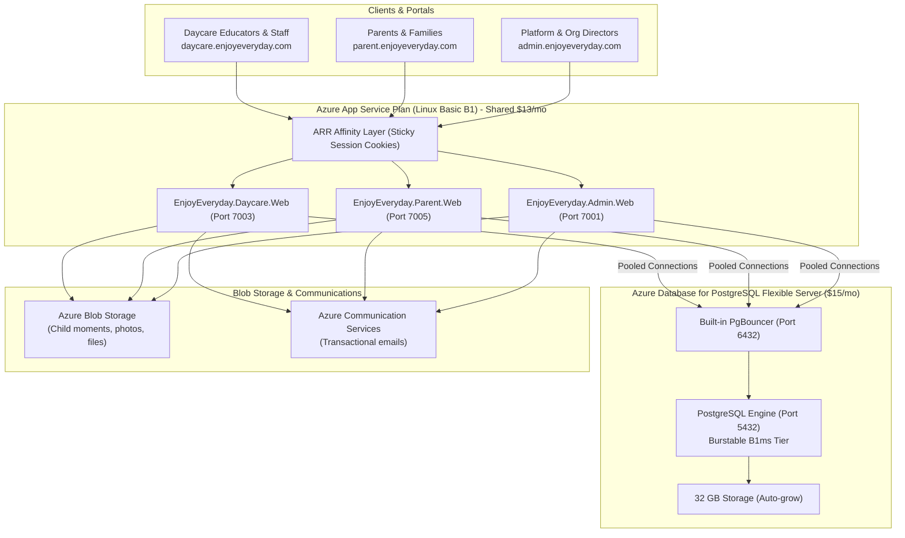

# Azure Deployment & Scalable Cloud Strategy

This document details the cost-effective, high-reliability deployment architecture for **EnjoyEveryday** on Microsoft Azure, covering compute, PostgreSQL, media storage, email infrastructure, and automated GitHub Actions CI/CD.

---

## 1. Executive Summary & Cost Profile

The deployment strategy is split into two phases:
1. **Bootstrapping / Startup Phase (Months 1–12)**: Designed for minimal operational expense while maintaining enterprise-grade reliability (~$30–$35/month).
2. **Growth / Scale Phase (50–200 Daycares)**: Smooth vertical/horizontal scaling without application rewrites (~$115/month).

### Cost Matrix Comparison

| Component | Azure Service | Startup Specification | Startup Cost (USD) | Scale Specification | Scale Cost (USD) |
|:---|:---|:---|:---|:---|:---|
| **Web Compute** | Azure App Service (Linux) | **Basic B1** (1 vCPU, 1.75 GB RAM)<br/>*All 3 portals on 1 plan* | **$13.14 / mo** | **Standard S1** (Auto-scale 2–3 nodes) | $54.75 / mo |
| **Relational DB** | Azure Database for PostgreSQL Flexible Server | **Burstable B1ms** (1 vCPU, 2 GB RAM, 32 GB SSD)<br/>*PgBouncer enabled* | **$15.20 / mo** | **Burstable B2s** or General Purpose D2s_v5 | $42.00 / mo |
| **Object / Media Storage** | Azure Blob Storage | Hot LRS (images, daily care moments) | **$1.50 / mo** (~50–100 GB) | Hot / Cool Tier (~1 TB) | $15.00 / mo |
| **Email Delivery** | Azure Communication Services (ACS) | Transactional Email | **$0.25 / mo** (1,000 emails) | Pay-as-you-go | $5.00 / mo |
| **Domain & SSL** | App Service Managed Certificate | SNI SSL (automated TLS renewal) | **$0.00** (Free) | Free Managed Cert | $0.00 |
| **CI/CD** | GitHub Actions | Automated build & deploy | **$0.00** (Free tier) | GitHub Actions | $0.00 |
| **Total** | | | **~$30.00 – $35.00 / mo** | | **~$115.00 / mo** |

---

## 2. Architecture & Topology



---

## 3. Detailed Component Breakdown

### 3.1. Web Compute: App Service (Linux) Shared Plan
* **Strategy**: Provision a single Linux App Service Plan (**Basic B1**, ~$13/month) and host all 3 web portals as separate App Service resources on that plan.
  - `enjoyeveryday-daycare` (Educator workspace & admin operations)
  - `enjoyeveryday-parent` (Parent timeline & moments)
  - `enjoyeveryday-admin` (Platform multi-tenant administration)
* **Blazor Server Circuit Handling**:
  - Blazor Server circuits maintain stateful WebSocket connections.
  - On Azure App Service, leave **ARR Affinity** set to **On** (default). Azure automatically sets an affinity cookie (`ARRAffinity`) so subsequent WebSocket packets from a parent or educator route directly to the instance holding their circuit in memory.
  - **Avoid Azure SignalR Service ($49/mo)** until scaling past 500+ active simultaneous circuits across 5+ web instances.

### 3.2. Relational Database: PostgreSQL Flexible Server
* **Strategy**: Provision **Azure Database for PostgreSQL Flexible Server** on tier **Burstable B1ms** (1 vCPU, 2 GB RAM, 32 GB storage) at ~$15/month.
* **Critical Configuration — PgBouncer Connection Pooling**:
  - PostgreSQL processes spawn a heavy backend worker per client connection.
  - Under **Server Parameters**, set **`pgbouncer.enabled = true`**.
  - Route application connection strings through port **`6432`** instead of `5432`.
  - This allows a small $15/month server to handle hundreds of concurrent requests without running out of connections or memory.
* **Auto-Grow Storage**: Enable storage auto-grow so the disk expands smoothly without manual intervention or downtime.

### 3.3. File & Media Storage: Azure Blob Storage
* **Strategy**: Standard General Purpose v2 Storage Account with **Hot LRS** replication.
* **Child Photos & Moments**: Never store binaries or base64 strings in PostgreSQL. Store files in a container (e.g., `child-moments/`, `documents/`) and save the resulting public or SAS URL in the database.
* **Cost**: ~$0.015 per GB/month (~$1.50 for 100 GB).

### 3.4. Transactional Emails: Azure Communication Services (ACS)
* **Strategy**: Use Azure Communication Services Email (already implemented via `AzureCommunicationEmailService.cs`).
* **Cost**: Flat rate of **$0.00025 per email** ($0.25 per 1,000 sent emails).
* Connects using Azure Managed Identity or Connection String without third-party subscriptions.

---

## 4. Configuration & Environment Variables

When configuring the Azure App Services, populate these standard application settings:

```ini
# PostgreSQL with PgBouncer
ConnectionStrings__DefaultConnection=Server=psql-enjoyeveryday-prod.postgres.database.azure.com;Port=6432;Database=enjoyeveryday;User Id=pgadmin;Password=YourSecurePassword;Ssl Mode=Require;Trust Server Certificate=true;

# Blob Storage
Azure__StorageConnectionString=DefaultEndpointsProtocol=https;AccountName=stenjoyeverydayprod;AccountKey=...;EndpointSuffix=core.windows.net

# Azure Communication Services (Email)
Azure__CommunicationServices__ConnectionString=endpoint=https://acs-enjoyeveryday-prod.unitedstates.communication.azure.com/;accesskey=...
Azure__CommunicationServices__SenderAddress=notifications@enjoyeveryday.com

# ASP.NET Core Settings
ASPNETCORE_ENVIRONMENT=Production
WEBSITE_HTTPLOGGING_RETENTION_DAYS=7
```

---

## 5. Automated CI/CD Pipeline (GitHub Actions)

A zero-maintenance deployment pipeline using GitHub Actions to automatically deploy updates to Azure App Service upon pushing to `master`:

```yaml
name: Deploy EnjoyEveryday Portals

on:
  push:
    branches: [ master ]

jobs:
  build-and-deploy:
    runs-on: ubuntu-latest
    steps:
      - name: Checkout Code
        uses: actions/checkout@v4

      - name: Setup .NET
        uses: actions/setup-dotnet@v4
        with:
          dotnet-version: '10.0.x'

      # 1. Daycare Web Portal
      - name: Publish Daycare Portal
        run: dotnet publish src/EnjoyEveryday.Daycare.Web/EnjoyEveryday.Daycare.Web.csproj -c Release -o ./publish-daycare

      - name: Deploy Daycare Portal to Azure
        uses: azure/webapps-deploy@v3
        with:
          app-name: 'enjoyeveryday-daycare'
          publish-profile: ${{ secrets.AZURE_DAYCARE_PUBLISH_PROFILE }}
          package: ./publish-daycare

      # 2. Parent Web Portal
      - name: Publish Parent Portal
        run: dotnet publish src/EnjoyEveryday.Parent.Web/EnjoyEveryday.Parent.Web.csproj -c Release -o ./publish-parent

      - name: Deploy Parent Portal to Azure
        uses: azure/webapps-deploy@v3
        with:
          app-name: 'enjoyeveryday-parent'
          publish-profile: ${{ secrets.AZURE_PARENT_PUBLISH_PROFILE }}
          package: ./publish-parent

      # 3. Platform Admin Portal
      - name: Publish Admin Portal
        run: dotnet publish src/EnjoyEveryday.Admin.Web/EnjoyEveryday.Admin.Web.csproj -c Release -o ./publish-admin

      - name: Deploy Admin Portal to Azure
        uses: azure/webapps-deploy@v3
        with:
          app-name: 'enjoyeveryday-admin'
          publish-profile: ${{ secrets.AZURE_ADMIN_PUBLISH_PROFILE }}
          package: ./publish-admin
```

---

## 6. Scaling Milestones & Trigger Points

| Threshold | Trigger Condition | Architectural Action | Estimated New Monthly Cost |
|:---|:---|:---|:---|
| **Phase 1: 1–10 Daycares** | Launch & early traction (0–300 children) | Keep on Basic B1 App Service + B1ms PostgreSQL. | **~$35 / month** |
| **Phase 2: 10–50 Daycares** | Memory utilization > 75% on App Service Plan | Upgrade App Service Plan to **Basic B2** or **Standard S1** (enables 2-instance auto-scaling). | **~$65 / month** |
| **Phase 3: 50–150 Daycares** | Peak DB CPU > 70% during 8:00 AM check-ins | Upgrade PostgreSQL Flexible Server from B1ms to **B2s** (2 vCPU, 4 GB RAM). | **~$115 / month** |
| **Phase 4: 150+ Daycares** | > 1,000 concurrent interactive WebSocket circuits | Add **Azure SignalR Service** to offload WebSocket TLS termination and connection state from Web VMs. | **~$220 / month** |
