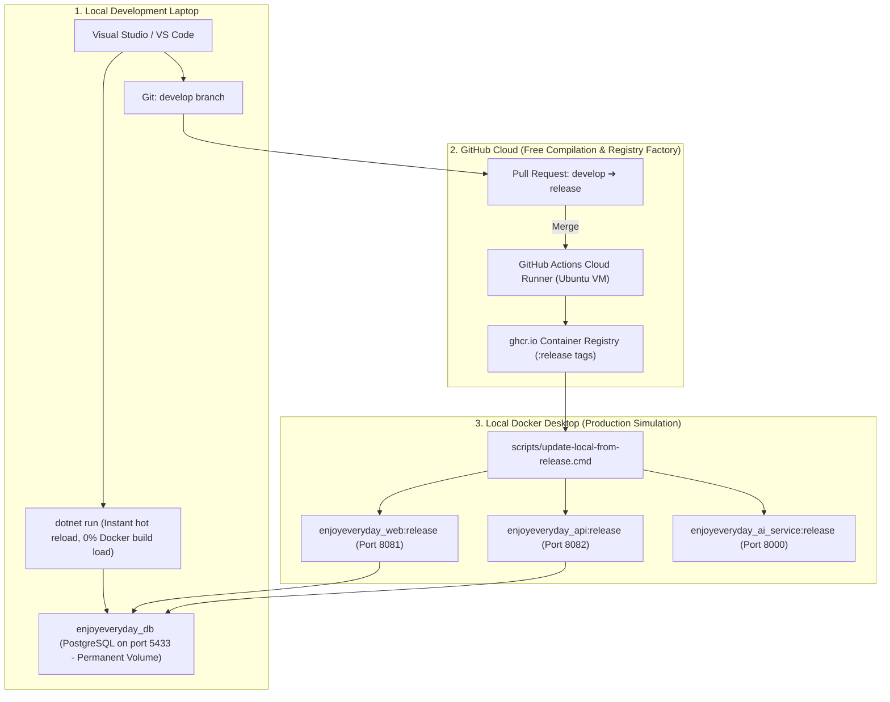
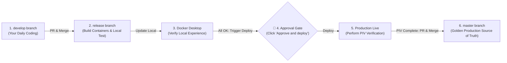
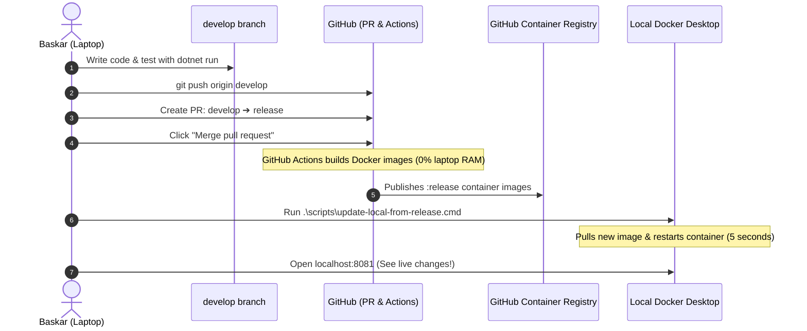

# EnjoyEveryday: The Complete Solo Developer Handbook
## Zero-to-Hero Guide: Architecture, Docker, Database Safety, CI/CD, and Production Simulation

> **Written for**: Baskar Kannappan  
> **Role**: Solo Full-Stack Developer  
> **Repository**: `EnjoyEveryday` (.NET 10 Blazor + Python FastAPI + PostgreSQL)  
> **Target Audience**: Fresher / Junior Engineer without agent tooling. Every concept, command, error, and architectural decision is explained from first principles with all minute details.

---

# Table of Contents
1. [The Big Picture: System Architecture](#1-the-big-picture-system-architecture)
2. [The 6 Core Components of EnjoyEveryday](#2-the-6-core-components-of-enjoyeveryday)
3. [The Resource Battle: Why Your Laptop Crashed & How We Solved It](#3-the-resource-battle-why-your-laptop-crashed--how-we-solved-it)
4. [Your Database: Why It Was Never Lost (Persistent Volumes)](#4-your-database-why-it-was-never-lost-persistent-volumes)
5. [The Zero-Data-Loss Database Strategy & 1-Click Backup](#5-the-zero-data-loss-database-strategy--1-click-backup)
6. [Git Branch Architecture: master, release, develop](#6-git-branch-architecture-master-release-develop)
7. [The Solo Developer Daily Pipeline (Option 2 Workflow)](#7-the-solo-developer-daily-pipeline-option-2-workflow)
8. [Demystifying GitHub Actions: Cloud CI vs. Local Database](#8-demystifying-github-actions-cloud-ci-vs-local-database)
9. [Authentication Deep Dive: Dev-Login vs. Real Google OAuth](#9-authentication-deep-dive-dev-login-vs-real-google-oauth)
10. [The Production Deployment & 3-Second Rollback Runbook](#10-the-production-deployment--3-second-rollback-runbook)
11. [Troubleshooting Dictionary: Every Error Encountered & The Exact Fix](#11-troubleshooting-dictionary-every-error-encountered--the-exact-fix)

---

# 1. The Big Picture: System Architecture

As a solo developer with **only 1 local laptop and 1 production server**, you do not have a dedicated corporate QA team or expensive staging cloud clusters. 

To survive and deliver enterprise-grade stability, we use a **3-tier strategy**:



### The Golden Philosophy:
* **Your Laptop** is for writing code and fast feedback (using native `dotnet run`).
* **GitHub Actions** is your heavy-lifting compilation factory (costs you 0 MB disk and 0% CPU on your laptop).
* **Docker Desktop** is for running lean, finished images to verify before production.

---

# 2. The 6 Core Components of EnjoyEveryday

Your platform consists of 6 microservices that work together inside Docker:

| # | Container Name | Technology | Local Port | URL | Purpose |
|:---|:---|:---|:---|:---|:---|
| **1** | `enjoyeveryday_db` | PostgreSQL 15/16 Alpine | `5433` (Host) $\rightarrow$ `5432` (Container) | `localhost:5433` | Stores all 172 database tables, children, attendance, billing, and roles. |
| **2** | `enjoyeveryday_ai_service` | Python 3.12, FastAPI, Gemini API | `8000` (Internal) | `http://ai-service:8000` | AI activity suggestions, lesson planning studio, and smart summarization. |
| **3** | `enjoyeveryday_api` | .NET 10 ASP.NET Core REST API | `8082` | `http://localhost:8082/swagger` | Central business logic, database queries, and repository coordinator. |
| **4** | `enjoyeveryday_web` | .NET 10 Blazor Server | `8081` | `http://localhost:8081` | Main Daycare Operations portal (Teachers, Classrooms, Attendance). |
| **5** | `enjoyeveryday_admin_web` | .NET 10 Blazor Server | `8084` | `http://localhost:8084` | Multi-tenant Platform & Organization Admin portal. |
| **6** | `enjoyeveryday_parent_web` | .NET 10 Blazor Server | `8085` | `http://localhost:8085` | Parent Portal (Moments, Daily care logs, Photos, Tuition fees). |

---

# 3. The Resource Battle: Why Your Laptop Crashed & How We Solved It

### The 4 Silent Killers of Laptop Performance:
1. **Docker Desktop Kubernetes**:
   * *What was happening*: When "Enable Kubernetes" was checked in Docker Desktop, it ran `etcd`, `kube-apiserver`, `kubelet`, and `coredns`. It burned **4 GB to 6 GB of RAM** just sitting idle with 0 apps running.
   * *The Fix*: Uncheck Kubernetes in Docker Desktop. Docker Compose gives the exact same container networking with **90% less RAM** (~200 MB total).
2. **WSL2 Virtual Disk Ballooning (`ext4.vhdx`)**:
   * *What was happening*: On Windows, Docker stores images inside a virtual Linux hard drive file. When you compile code or pull images, it expands dynamically (up to 100 GB). **Windows WSL2 never shrinks it automatically**, slowly eating all your C: drive space until Windows freezes.
   * *The Fix*: Add `%USERPROFILE%\.wslconfig` with `memory=6GB` and run `docker builder prune -a -f` periodically.
3. **The 350 MB Database Backup Loophole in `.dockerignore`**:
   * *What was happening*: Your `.dockerignore` file only excluded `**/database_backups` (with an underscore). Your backup script was creating files in `database\backups\` (with a forward slash). Every time you ran `docker build`, Docker packaged **350 MB+ of binary `.dump` files** and uploaded them into the build cache!
   * *The Fix*: Updated `.dockerignore` to ignore `**/database/backups/**`, `**/*.dump`, and `**/*.sql`.
4. **Multi-Stage Build SDK Discarding**:
   * *What was happening*: The .NET 10 SDK is ~950 MB. Compiling 5 projects locally cached gigabytes of NuGet packages and `.obj` files in Docker.
   * *The Fix*: We offloaded image creation to GitHub Actions. GitHub builds the image in the cloud, throws away the 950 MB SDK, and gives you a lean **~115 MB runtime image** that downloads in 10 seconds!

---

# 4. Your Database: Why It Was Never Lost (Persistent Volumes)

### Containers are Disposable, Volumes are Permanent
In Docker, containers are designed to be deleted and recreated at any time. **Data is NOT stored inside the container.**

Your database uses a **Docker Volume** defined in `docker-compose.yml`:
```yaml
services:
  db:
    image: postgres:15-alpine
    container_name: enjoyeveryday_db
    volumes:
      - postgres_data:/var/lib/postgresql/data # <--- Dedicated permanent disk space
```

### What This Means:
* When you run `docker compose down`, Docker stops and removes the `enjoyeveryday_db` container.
* **The `postgres_data` volume is NOT touched.** All 172 tables, all teachers, and all children remain safe on your hard drive.
* When you run `docker compose up -d`, Docker starts a new `enjoyeveryday_db` container and plugs it right back into the existing `postgres_data` volume.

> [!CAUTION]
> **The ONE Command You Must NEVER Run**:
> `docker compose down -v`  
> The `-v` flag stands for **Volume Delete**. It commands Docker to permanently destroy your database files. **Never type `-v` when taking down containers.**

---

# 5. The Zero-Data-Loss Database Strategy & 1-Click Backup

### 1-Click Safety Backup Tool: `scripts\backup-db.cmd`
Whenever you want to take an instant snapshot before doing experimental work, run:
```powershell
.\scripts\backup-db.cmd
```
This script automatically:
1. Connects to `localhost:5433` via PostgreSQL CLI.
2. Creates a timestamped **compressed binary archive (`.dump`)** in `database\backups\`.
3. Creates a timestamped **plain text SQL script (`.sql`)** in `database\backups\`.
4. Verifies the files are written safely to disk.

### How to Restore (If Ever Needed):
```powershell
$env:PGPASSWORD="postgres"
& "C:\Program Files\PostgreSQL\18\bin\pg_restore.exe" -h localhost -p 5433 -U postgres -d enjoyeveryday --clean --if-exists database\backups\enjoyeveryday_backup_YYYYMMDD_HHMMSS.dump
```

### The 3 Golden Rules of Database Changes:
1. **Always Use Transactional DDL (`BEGIN; ... COMMIT;`)**: If line 4 fails, the entire transaction rolls back automatically.
2. **Expand-and-Contract Pattern**: Always add new columns with `DEFAULT` or `NULL` first. Never delete old columns until the new code has run in production for days.
3. **Code Bug $\neq$ Database Restore**: If your application crashes or has a UI bug, roll back the container image using `deploy.ps1 -Rollback`. **Never restore an old database snapshot to fix a code bug**, because restoring a database wipes out all check-ins, attendance, and logs created since that snapshot!

---

# 6. Git Branch Architecture: master, release, develop

Your software lifecycle follows an enterprise 3-tier release pipeline:



| Branch Name | Role & Responsibility in Lifecycle | How Code Enters |
|:---|:---|:---:|
| **`develop`** | **Daily Active Workbench**: Where you write code, add features, fix bugs, and test natively using `dotnet run` (Port 7003). | Direct Commits / Feature branches |
| **`release`** | **Release Candidate & Local Staging**: Holds code ready for containerization. Merging code here triggers cloud Docker builds. You pull this to your laptop Docker Desktop to test and verify before going live. | Pull Request from `develop` |
| **`master`** | **Golden Production Baseline**: Holds the exact, verified code running live in production *after* successful deployment and Post-Implementation Verification (PIV). | Pull Request from `release` (Post-PIV) |
| `old-develop` / `old-release` | Archived legacy branches kept for historical reference. | Read-only |

*(Note: The old default branch `HiCanadaMain` has been safely retired and deleted).*

---

# 7. The Solo Developer Daily Pipeline (Option 2 Workflow)

This is the automated, effortless pipeline designed for your single laptop:



### Step-by-Step Instructions:

#### Step 1: Write Code on `develop`
Make sure you are on the `develop` branch:
```powershell
git checkout develop
```
Develop features using native .NET (fast hot reload on `http://localhost:7003`):
```powershell
dotnet run --project src/EnjoyEveryday.Daycare.Web/EnjoyEveryday.Daycare.Web.csproj
```

#### Step 2: Commit & Push to `develop`
```powershell
git add .
git commit -m "feat(ui): add new classroom dashboard widget"
git push origin develop
```

#### Step 3: Open and Merge Pull Request to `release`
1. Open GitHub in browser: **[Create PR: develop ➔ release](https://github.com/baskarkannappan/EnjoyEveryday/compare/release...develop)**
2. Click **"Create pull request"**.
3. Click **"Merge pull request"** and confirm.

#### Step 4: Watch GitHub Actions Build
Open: **[GitHub Actions Runs](https://github.com/baskarkannappan/EnjoyEveryday/actions)**
* The **UI CI**, **API CI**, or **AI Service CI** workflow will run in GitHub's cloud.
* When finished (green checkmark), it automatically publishes the image to:
  `ghcr.io/baskarkannappan/enjoyeveryday-ui:release`

#### Step 5: Update Local Docker Desktop in 1 Click!
Open your PowerShell terminal and run:
```powershell
.\scripts\update-local-from-release.cmd
```
This single command pulls the new `:release` image and restarts only the web container in **~5 seconds**. Your database container is untouched, and your data remains 100% intact!

#### Step 6: Verify Locally, then Approve & Deploy to Production
1. Open `http://localhost:8081` and verify your changes in Docker Desktop.
2. When satisfied, go to **[GitHub Actions ➔ Production Deploy](https://github.com/baskarkannappan/EnjoyEveryday/actions/workflows/production-deploy.yml)**.
3. Click **"Run workflow"** (Branch: `release`, Tag: `release`, Service: `all`).
4. GitHub verifies the images and **pauses at the Production Gate**.
5. Click **"Review deployments"** ➔ check `production` ➔ click **"Approve and deploy"**!

#### Step 7: PIV Verification & Merge to `master` (The Golden Archive)
1. Perform your Post-Implementation Verification (PIV) on the live production environment.
2. Once verified and healthy, open GitHub and create a Pull Request: **`release` ➔ `master`**.
3. Merge the PR.
4. **`master`** now officially holds the verified, working version running in production!


---

# 8. Demystifying GitHub Actions: Cloud CI vs. Local Database

### Why did "Database CI" fail in GitHub Actions with a Red `(X)`?
During our pipeline test, you saw a red cross on `Database CI (PostgreSQL Migrations)`. **Do not panic!**

Here are the facts:
1. **GitHub Actions runs in GitHub Cloud (Microsoft Azure)**:
   It runs on an Ubuntu Linux virtual machine in GitHub’s remote datacenter.
2. **GitHub has ZERO access to your laptop**:
   GitHub servers cannot connect to your laptop, cannot see port 5433, and have no network credentials to your machine. **GitHub can NEVER touch or destroy your local database.**
3. **What failed?**
   In GitHub's cloud, it spun up a temporary, blank throwaway database to test if all 142 historical SQL migration files could run sequentially from scratch. An older migration script had a syntax issue on a blank database. It has zero effect on your working local database.
4. **Notice the other workflows passed**:
   - `UI CI (.NET Blazor Portals)`: **Passed (Green Check)**
   - `API CI (.NET ASP.NET Core)`: **Passed (Green Check)**
   - `AI Service CI (FastAPI)`: **Passed (Green Check)**

---

# 9. Authentication Deep Dive: Dev-Login vs. Real Google OAuth

### 1. Dev-Login Mode (`ASPNETCORE_ENVIRONMENT=Development`)
* **When to use**: Quick local development and automated testing without internet or Google accounts.
* **How it works**:
  * You click "Sign In".
  * It routes to `/auth/dev-login`.
  * The PostgreSQL stored procedure `fn_dev_login` logs you in automatically.
  * *Why Priya Sharma?* In `fn_dev_login`, if no email parameter is passed in the URL, it defaults to `PRIYA@LITTLESTARS.COM` (pre-seeded lead teacher).
  * *To log in as yourself in Dev Mode*:
    `http://localhost:8081/auth/dev-login?email=baskar.kannappan@gmail.com`
  * *To log in as Platform Admin in Dev Mode*:
    `http://localhost:8081/auth/dev-login?email=admin@littlestars.com`

### 2. Production Simulation Mode (`ASPNETCORE_ENVIRONMENT=Production`)
* **When to use**: To test the exact production authentication flow.
* **How it works**:
  * Dev-login endpoints are strictly blocked.
  * When you click "Sign In", your browser redirects to official Google OAuth:
    `https://accounts.google.com/o/oauth2/v2/auth?client_id=...`
  * You pick your Google account (`baskar.kannappan@gmail.com`).
  * Google sends the authenticated identity back to `http://localhost:8081/signin-google`.
  * The application matches your Google email with your user record in PostgreSQL and signs you in as **Baskar Kannappan**.

### The `.env` Configuration for Production:
```ini
ASPNETCORE_ENVIRONMENT=Production
GOOGLE_CLIENT_ID=your-google-client-id.apps.googleusercontent.com
GOOGLE_CLIENT_SECRET=your-google-client-secret
```

---

# 10. The Production Deployment & Approval Gate Runbook

Once you have verified your changes in your local Docker Desktop (`http://localhost:8081`) and are ready to deploy to Production:

### The Complete Production Flow:
```
Local Docker Desktop Tested (All OK) ➔ Merge release into master ➔ GitHub Actions triggers Production Workflow ➔ 🛑 PAUSES AT APPROVAL GATE ➔ You click "Approve and deploy" ➔ Deploys to Production!
```

---

### How to Enable the Manual Approval Gate in GitHub (One-Time Setup):
To make GitHub pause and require your personal click before deploying to production:
1. Open your repository on GitHub: **`https://github.com/baskarkannappan/EnjoyEveryday`**
2. Go to **Settings** (top navigation tab with gear icon).
3. In the left sidebar, click **Environments**.
4. Click the green **"New environment"** button.
5. Name it exactly: **`production`** and click **"Configure environment"**.
6. Under **Environment protection rules**:
   - Check the box: **"Required reviewers"**.
   - Search and select your GitHub username: **`baskarkannappan`**.
7. Click **"Save protection rules"**.

> **Result**: Whenever `.github/workflows/production-deploy.yml` runs, GitHub will **HALT** at the `deploy-to-production` job. It will show an orange status: *"Waiting for review"*. You simply click **"Review deployments"** ➔ check `production` ➔ click **"Approve and deploy"**!

---

### How to Trigger Production Deployment:

#### Method A: Automatic (Merge `release` ➔ `master`)
When you are satisfied with your local testing, create and merge a PR from `release` into `master`. The workflow will trigger automatically and pause at your gate.

#### Method B: Manual (On-Demand from GitHub UI)
1. Go to **[GitHub Actions](https://github.com/baskarkannappan/EnjoyEveryday/actions)**.
2. In the left list, click **Production Deploy & Rollback**.
3. Click the **"Run workflow"** button on the right:
   - Branch: `master`
   - Target Tag: `release` (or specific commit SHA)
   - Service: `all`
4. Click green **"Run workflow"**.
5. Once the verification stage passes, click **"Review deployments"** ➔ **"Approve and deploy"**.

---

### Local Production Server Deployment & 3-Second Rollback (Direct CLI):

Whenever you deploy directly on a production server:

### Step 1: Take Pre-Deployment Backup Snapshot
```powershell
.\scripts\backup-db.cmd
```
*(Creates `database\backups\enjoyeveryday_backup_YYYYMMDD_HHMMSS.dump` and `.sql`).*

### Step 2: Apply Database Changes (If Any)
```powershell
scripts\db.cmd -f database\migrations\your_new_migration.sql
```

### Step 3: Deploy the Updated Containers
```powershell
# Deploy single service:
.\scripts\deploy.ps1 -Service web -Tag release

# Or deploy all services:
.\scripts\deploy.ps1 -Service all -Tag release
```

### Step 4: Emergency Rollback (If Code Has Bugs)
If the new code crashes or has bugs:
```powershell
.\scripts\deploy.ps1 -Service web -Rollback
```
* Reverts to the previous image in **3 seconds**.
* Database is untouched.
* Zero data loss.

---

# 11. Troubleshooting Dictionary: Every Error Encountered & The Exact Fix

Keep this dictionary handy. If you see any of these errors in the future, here is the exact diagnosis:

### Error 1: `A parameter cannot be found that matches parameter name 'AsHashtable'`
* **Cause**: Running `deploy.ps1` in standard Windows PowerShell 5.1 where `ConvertFrom-Json -AsHashtable` does not exist (it is a PowerShell Core 7+ only parameter).
* **Fix**: In `deploy.ps1`, parse the JSON object into a hashtable manually:
  ```powershell
  $parsed = $raw | ConvertFrom-Json
  foreach ($prop in $parsed.PSObject.Properties) { $ht[$prop.Name] = ... }
  ```

---

### Error 2: `google_not_configured` in Development Mode
* **Cause**: Inside Docker, `RemoteIpAddress` is the internal Docker gateway (`::ffff:172.19.0.1`). The old code required `IPAddress.IsLoopback(remoteIp)`, which returned `false`.
* **Fix**: Added `DOTNET_RUNNING_IN_CONTAINER=true` check in `AuthEndpoints.cs` so local Docker requests are recognized.

---

### Error 3: `ai-service:sha-xxxxxxx: not found` on `-Service all`
* **Cause**: In GitHub Actions, `AI Service CI` only triggers when `src/EnjoyEveryday.AiAgent/` files change. If your latest commit only modified `.Web` files, GitHub never built a new AI image with that commit SHA.
* **Fix**: Use branch tags like `:release` or specify individual service tags in `.env`.

---

### Error 4: `Conflict. The container name "/enjoyeveryday_web" is already in use`
* **Cause**: A container was created manually with `docker run --name enjoyeveryday_web`, blocking `docker compose` from reusing that name.
* **Fix**:
  ```powershell
  docker rm -f enjoyeveryday_web
  ```

---

### Error 5: `.scripts/deploy.ps1 : The term '.scripts/deploy.ps1' is not recognized`
* **Cause**: A typo missing the slash after the dot.
* **Fix**: Always use a backslash or slash: `.\scripts\deploy.ps1` or `./scripts/deploy.ps1`.

---

### Error 6: `Empty tables` in DBeaver / DB Viewer on port 5433
* **Cause**: DBeaver connected by default to PostgreSQL's empty maintenance database named `postgres`.
* **Fix**: Right-click connection $\rightarrow$ Edit Connection $\rightarrow$ change Database to **`enjoyeveryday`**.

---

### Error 7: .NET ignores `GOOGLE_CLIENT_ID` in `.env`
* **Cause**: In .NET configuration, an empty value in `appsettings.json` (`"Authentication": { "Google": { "ClientId": "" } }`) is a non-null string. The C# null-coalescing operator `??` will not fall back to `Environment.GetEnvironmentVariable()`.
* **Fix**: Use double underscores in `docker-compose.yml` to override nested JSON keys:
  ```yaml
  Authentication__Google__ClientId: ${GOOGLE_CLIENT_ID:-}
  Authentication__Google__ClientSecret: ${GOOGLE_CLIENT_SECRET:-}
  ```

---

### Error 8: `GitHub Push Protection` Blocks Push Due to Secret
* **Cause**: Real Google OAuth Client Secret or API key accidentally pasted into markdown docs or git-tracked files.
* **Fix**: Replace real secrets with placeholders like `your-google-client-secret` in docs. Keep all real secrets inside `.env` (which is in `.gitignore`). Amend the git commit and push.

---

### Error 9: `Database CI (PostgreSQL Migrations)` Fails on GitHub Actions
* **Cause**: GitHub Actions spins up a temporary PostgreSQL instance on an Ubuntu cloud runner to test legacy migration files from scratch.
* **Fix**: This does **not** touch or affect your local machine. You can safely ignore cloud migration test failures as long as your local database has the migrations applied, or update the cloud migration script.

---

*EnjoyEveryday Platform Handbook | Maintained by Baskar Kannappan*
