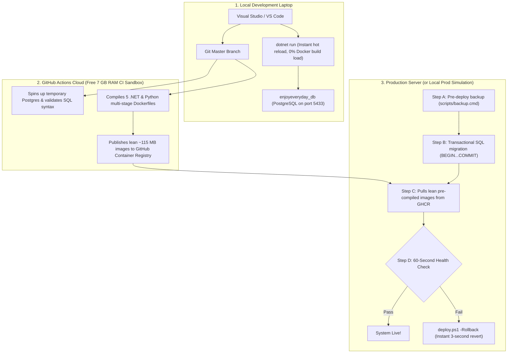

# EnjoyEveryday: The Complete Solo Developer Handbook
## Zero-to-Hero Guide: Architecture, Docker, Database Safety, CI/CD, and Production Simulation

> **Written for**: Baskar Kannappan  
> **Role**: Solo Full-Stack Developer  
> **Repository**: `EnjoyEveryday` (.NET 10 Blazor + Python FastAPI + PostgreSQL)  
> **Target Audience**: Fresher / Junior Engineer without agent tooling. Every concept, command, error, and architectural decision is explained from first principles with all minute details.

---

# Table of Contents
1. [The Big Picture: System Architecture](#1-the-big-picture-system-architecture)
2. [The 6 Core Components of EnjoyEveryday](#2-the-6-core-components-of-enjoyeveryday)
3. [The Resource Battle: Why Your Laptop Crashed & How We Solved It](#3-the-resource-battle-why-your-laptop-crashed--how-we-solved-it)
4. [Your Database: Why It Was Never Lost (Persistent Volumes)](#4-your-database-why-it-was-never-lost-persistent-volumes)
5. [The Zero-Data-Loss Database Migration Strategy](#5-the-zero-data-loss-database-migration-strategy)
6. [The 4-Step Daily Routine (Morning, Day, Evening, Night)](#6-the-4-step-daily-routine-morning-day-evening-night)
7. [Authentication Deep Dive: Dev-Login vs. Real Google OAuth](#7-authentication-deep-dive-dev-login-vs-real-google-oauth)
8. [The Production Deployment & 3-Second Rollback Runbook](#8-the-production-deployment--3-second-rollback-runbook)
9. [Troubleshooting Dictionary: Every Error Encountered & The Exact Fix](#9-troubleshooting-dictionary-every-error-encountered--the-exact-fix)

---

# 1. The Big Picture: System Architecture

As a solo developer with **only 1 local laptop and 1 production server**, you do not have a dedicated corporate QA team or expensive staging cloud clusters. 

To survive and deliver enterprise-grade stability, we use a **3-tier strategy**:



### The Golden Philosophy:
* **Your Laptop** is for writing code and fast feedback.
* **GitHub Actions** is your heavy-lifting compilation factory (costs you 0 MB disk and 0% CPU).
* **Production / Docker Desktop** is for running lean, finished images.

---

# 2. The 6 Core Components of EnjoyEveryday

Your platform consists of 6 microservices that work together inside Docker:

| # | Container Name | Technology | Local Port | URL | Purpose |
|:---|:---|:---|:---|:---|:---|
| **1** | `enjoyeveryday_db` | PostgreSQL 15/16 Alpine | `5433` (Host) $\rightarrow$ `5432` (Container) | `localhost:5433` | Stores all 172 database tables, children, attendance, billing, and roles. |
| **2** | `enjoyeveryday_ai_service` | Python 3.12, FastAPI, Gemini API | `8000` (Internal) | `http://ai-service:8000` | AI activity suggestions, lesson planning studio, and smart summarization. |
| **3** | `enjoyeveryday_api` | .NET 10 ASP.NET Core REST API | `8082` | `http://localhost:8082/swagger` | Central business logic, database queries, and repository coordinator. |
| **4** | `enjoyeveryday_web` | .NET 10 Blazor Server | `8081` | `http://localhost:8081` | Main Daycare Operations portal (Teachers, Classrooms, Attendance). |
| **5** | `enjoyeveryday_admin_web` | .NET 10 Blazor Server | `8084` | `http://localhost:8084` | Multi-tenant Platform & Organization Admin portal. |
| **6** | `enjoyeveryday_parent_web` | .NET 10 Blazor Server | `8085` | `http://localhost:8085` | Parent Portal (Moments, Daily care logs, Photos, Tuition fees). |

---

# 3. The Resource Battle: Why Your Laptop Crashed & How We Solved It

### The 4 Silent Killers of Laptop Performance:
1. **Docker Desktop Kubernetes**:
   * *What was happening*: When "Enable Kubernetes" was checked in Docker Desktop, it ran `etcd`, `kube-apiserver`, `kubelet`, and `coredns`. It burned **4 GB to 6 GB of RAM** just sitting idle with 0 apps running.
   * *The Fix*: Uncheck Kubernetes in Docker Desktop. Docker Compose gives the exact same container networking with **90% less RAM** (~200 MB total).
2. **WSL2 Virtual Disk Ballooning (`ext4.vhdx`)**:
   * *What was happening*: On Windows, Docker stores images inside a virtual Linux hard drive file. When you compile code or pull images, it expands dynamically (up to 100 GB). **Windows WSL2 never shrinks it automatically**, slowly eating all your C: drive space until Windows freezes.
   * *The Fix*: Add `%USERPROFILE%\.wslconfig` with `memory=6GB` and run `docker builder prune -a -f` periodically.
3. **The 350 MB Database Backup Loophole in `.dockerignore`**:
   * *What was happening*: Your `.dockerignore` file only excluded `**/database_backups` (with an underscore). Your backup script was creating files in `database\backups\` (with a forward slash). Every time you ran `docker build`, Docker packaged **350 MB+ of binary `.dump` files** and uploaded them into the build cache!
   * *The Fix*: Updated `.dockerignore` to ignore `**/database/backups/**`, `**/*.dump`, and `**/*.sql`.
4. **Multi-Stage Build SDK Discarding**:
   * *What was happening*: The .NET 10 SDK is ~950 MB. Compiling 5 projects locally cached gigabytes of NuGet packages and `.obj` files in Docker.
   * *The Fix*: We offloaded image creation to GitHub Actions. GitHub builds the image in the cloud, throws away the 950 MB SDK, and gives you a lean **~115 MB runtime image** that downloads in 10 seconds!

---

# 4. Your Database: Why It Was Never Lost (Persistent Volumes)

### Containers are Disposable, Volumes are Permanent
In Docker, containers are designed to be deleted and recreated at any time. **Data is NOT stored inside the container.**

Your database uses a **Docker Volume** defined in `docker-compose.yml`:
```yaml
services:
  db:
    image: postgres:15-alpine
    container_name: enjoyeveryday_db
    volumes:
      - postgres_data:/var/lib/postgresql/data # <--- Dedicated disk space
```

### What This Means:
* When you run `docker compose down`, Docker stops and removes the `enjoyeveryday_db` container.
* **The `postgres_data` volume is NOT touched.** All 172 tables, all teachers, and all children remain safe on your hard drive.
* When you run `docker compose up -d`, Docker starts a new `enjoyeveryday_db` container and plugs it right back into the existing `postgres_data` volume.

> [!CAUTION]
> **The ONE Command You Must NEVER Run**:
> `docker compose down -v`  
> The `-v` flag stands for **Volume Delete**. It commands Docker to permanently destroy your database files. **Never type `-v` when taking down containers.**

---

# 5. The Zero-Data-Loss Database Migration Strategy

When updating tables in production, you cannot just drop tables or run unchecked commands.

### Rule 1: Always Use Transactional DDL (`BEGIN; ... COMMIT;`)
PostgreSQL allows DDL (schema alterations) inside transactions. If line 4 fails, lines 1, 2, and 3 are completely undone:
```sql
BEGIN;

-- Add new column with safe default (Metadata-only in Postgres 11+, zero table lock)
ALTER TABLE children 
    ADD COLUMN IF NOT EXISTS dietary_allergies TEXT DEFAULT '';

-- Add index safely
CREATE INDEX IF NOT EXISTS idx_children_allergies ON children(tenant_id, dietary_allergies);

COMMIT;
```

### Rule 2: The Expand-and-Contract Pattern (Never Break Old Code)
* **Step 1 (Expand)**: Add the new column with `DEFAULT` or allowing `NULL`.
* **Step 2 (Deploy Code)**: Deploy your new app container. If the new code has bugs and you need to roll back, the old container can still run because you didn't delete the old column!
* **Step 3 (Contract - days later)**: Drop or archive the deprecated column once the new release is proven stable.

### Rule 3: The Routine Rollback vs Nuclear Restore Rule
* **If code fails**: Run `.\scripts\deploy.ps1 -Service web -Rollback` (Takes 3 seconds, 0 data loss).
* **Never restore a database backup just because code has a bug!** Restoring a backup destroys every attendance, check-in, and meal logged by teachers between the backup and the restore! Backup restores are only for catastrophic disk failure or accidental table drops.

---

# 6. The 4-Step Daily Routine

### Step 1: Morning Startup (5 Seconds)
When you sit down to work:
```powershell
docker compose up -d
```
All 6 services will start up with green icons in Docker Desktop:
* Daycare Web: `http://localhost:8081`
* Admin Web: `http://localhost:8084`
* Parent Portal: `http://localhost:8085`
* Backend API: `http://localhost:8082/swagger`
* Database: `localhost:5433`

---

### Step 2: Daily Coding (Fast Native Mode - No Heavy Docker Rebuilding)
If you are developing a new Blazor feature or fixing a C# bug in `EnjoyEveryday.Daycare.Web`:
1. Keep the database running in Docker (`localhost:5433`).
2. Run your web app directly on your laptop using .NET CLI (or press F5 in Visual Studio):
   ```powershell
   dotnet run --project src/EnjoyEveryday.Daycare.Web/EnjoyEveryday.Daycare.Web.csproj
   ```
3. Open `http://localhost:7003` with instant hot-reload.

---

### Step 3: Pushing Your Changes
When your feature or fix is ready:
```powershell
git add .
git commit -m "feat: descriptive message of what you changed"
git push origin master
```
* GitHub Actions will automatically test your database migration on a cloud throwaway database, compile your Docker containers in the cloud, and push new images to GitHub Packages (`ghcr.io`).

---

### Step 4: Bedtime Shutdown (Free RAM & Battery)
Before turning off your laptop:
```powershell
docker compose down
```
*(Containers stop, RAM is freed, all database data is 100% saved in the persistent volume).*

---

# 7. Authentication Deep Dive: Dev-Login vs. Real Google OAuth

This was the source of the `google_not_configured` and "Priya Sharma" confusion during our session. Here is how authentication works under the hood:

### 1. Dev-Login Mode (`ASPNETCORE_ENVIRONMENT=Development`)
* **When to use**: Quick local development and automated testing without internet or Google accounts.
* **How it works**:
  * You click "Sign In".
  * It routes to `/auth/dev-login`.
  * The PostgreSQL stored procedure `fn_dev_login` logs you in automatically.
  * *Why Priya Sharma?* In `fn_dev_login`, if no email parameter is passed in the URL, it defaults to:
    ```sql
    WHERE normalized_email = 'PRIYA@LITTLESTARS.COM'
    ```
    Priya Sharma is the pre-seeded lead teacher of *Little Stars Daycare*.
  * *To log in as yourself in Dev Mode*:
    Open: `http://localhost:8081/auth/dev-login?email=baskar.kannappan@gmail.com`
  * *To log in as Platform Admin in Dev Mode*:
    Open: `http://localhost:8081/auth/dev-login?email=admin@littlestars.com`

### 2. Production Simulation Mode (`ASPNETCORE_ENVIRONMENT=Production`)
* **When to use**: To test the exact production authentication flow.
* **How it works**:
  * Dev-login endpoints are strictly blocked.
  * When you click "Sign In", your browser redirects to official Google OAuth:
    `https://accounts.google.com/o/oauth2/v2/auth?client_id=...`
  * You pick your Google account (`baskar.kannappan@gmail.com`).
  * Google sends the authenticated identity back to `http://localhost:8081/signin-google`.
  * The application matches your Google email with your user record in PostgreSQL and signs you in as **Baskar Kannappan**.

### The `.env` Configuration for Production:
```ini
ASPNETCORE_ENVIRONMENT=Production
GOOGLE_CLIENT_ID=your-google-client-id.apps.googleusercontent.com
GOOGLE_CLIENT_SECRET=your-google-client-secret
```

### The Google Cloud Console Configuration:
Under [Google Cloud Console Credentials](https://console.cloud.google.com/auth/clients?project=enjoyeveryday) $\rightarrow$ `EnjoyEveryday Local Web`:
**Authorized redirect URIs**:
* `http://localhost:8081/signin-google`
* `http://localhost:8084/signin-google`
* `http://localhost:8085/signin-google`

---

# 8. The Production Deployment & 3-Second Rollback Runbook

Whenever you deploy to your production server:

### Step 1: Take Pre-Deployment Backup Snapshot
```powershell
scripts\backup.cmd
```
*(Creates `database\backups\enjoyeveryday_backup_YYYYMMDD_HHMM.dump` and `.sql`. Verify file size > 0!)*

### Step 2: Apply Database Changes
```powershell
psql -h localhost -p 5433 -U postgres -d enjoyeveryday -f scripts\migrations\your_migration.sql
```

### Step 3: Deploy the Updated Containers
```powershell
# Deploy single service:
.\scripts\deploy.ps1 -Service web -Tag sha-xxxxxxx

# Or deploy all services:
.\scripts\deploy.ps1 -Service all -Tag sha-xxxxxxx
```

### Step 4: Emergency Rollback (If Code Has Bugs)
If the new code crashes or has bugs:
```powershell
.\scripts\deploy.ps1 -Service web -Rollback
```
* Reverts to the previous Git SHA tag in **3 seconds**.
* Database is untouched.
* Zero data loss.

---

# 9. Troubleshooting Dictionary: Every Error Encountered & The Exact Fix

Keep this dictionary handy. If you see any of these errors in the future, here is the exact diagnosis:

### Error 1: `A parameter cannot be found that matches parameter name 'AsHashtable'`
* **Cause**: Running `deploy.ps1` in standard Windows PowerShell 5.1 where `ConvertFrom-Json -AsHashtable` does not exist (it is a PowerShell Core 7+ only parameter).
* **Fix**: In `deploy.ps1`, parse the JSON object into a hashtable manually:
  ```powershell
  $parsed = $raw | ConvertFrom-Json
  foreach ($prop in $parsed.PSObject.Properties) { $ht[$prop.Name] = ... }
  ```

---

### Error 2: `google_not_configured` in Development Mode
* **Cause**: Two possible reasons:
  1. `ASPNETCORE_ENVIRONMENT=Production` was set, which disables dev login.
  2. Inside Docker, `RemoteIpAddress` is the internal Docker gateway (`::ffff:172.19.0.1`). The old code required `IPAddress.IsLoopback(remoteIp)`, which returned `false`.
* **Fix**: Added `DOTNET_RUNNING_IN_CONTAINER=true` check in `AuthEndpoints.cs` so local Docker requests are recognized.

---

### Error 3: `ai-service:sha-xxxxxxx: not found` on `-Service all`
* **Cause**: In GitHub Actions, `AI Service CI` only triggers when `src/EnjoyEveryday.AiAgent/` files change. If your latest commit only modified `.Web` files, GitHub never built a new AI image with that commit SHA.
* **Fix**: In `.env`, specify the latest tag where that service was actually built (e.g. `UI_TAG=sha-d47df94` and `AI_TAG=sha-6d2b1cd`).

---

### Error 4: `Conflict. The container name "/enjoyeveryday_web" is already in use`
* **Cause**: A container was created manually with `docker run --name enjoyeveryday_web`, blocking `docker compose` from reusing that name.
* **Fix**:
  ```powershell
  docker rm -f enjoyeveryday_web
  ```

---

### Error 5: `.scripts/deploy.ps1 : The term '.scripts/deploy.ps1' is not recognized`
* **Cause**: A typo missing the slash after the dot.
* **Fix**: Always use a backslash or slash: `.\scripts\deploy.ps1` or `./scripts/deploy.ps1`.

---

### Error 6: `Empty tables` in DBeaver / DB Viewer on port 5433
* **Cause**: DBeaver connected by default to PostgreSQL's empty maintenance database named `postgres`.
* **Fix**: Right-click connection $\rightarrow$ Edit Connection $\rightarrow$ change Database to **`enjoyeveryday`**.

---

### Error 7: .NET ignores `GOOGLE_CLIENT_ID` in `.env`
* **Cause**: In .NET configuration, an empty value in `appsettings.json` (`"Authentication": { "Google": { "ClientId": "" } }`) is a non-null string. The C# null-coalescing operator `??` will not fall back to `Environment.GetEnvironmentVariable()`.
* **Fix**: Use double underscores in `docker-compose.yml` to override nested JSON keys:
  ```yaml
  Authentication__Google__ClientId: ${GOOGLE_CLIENT_ID:-}
  Authentication__Google__ClientSecret: ${GOOGLE_CLIENT_SECRET:-}
  ```

---

*EnjoyEveryday Platform Handbook | Maintained by Baskar Kannappan*
