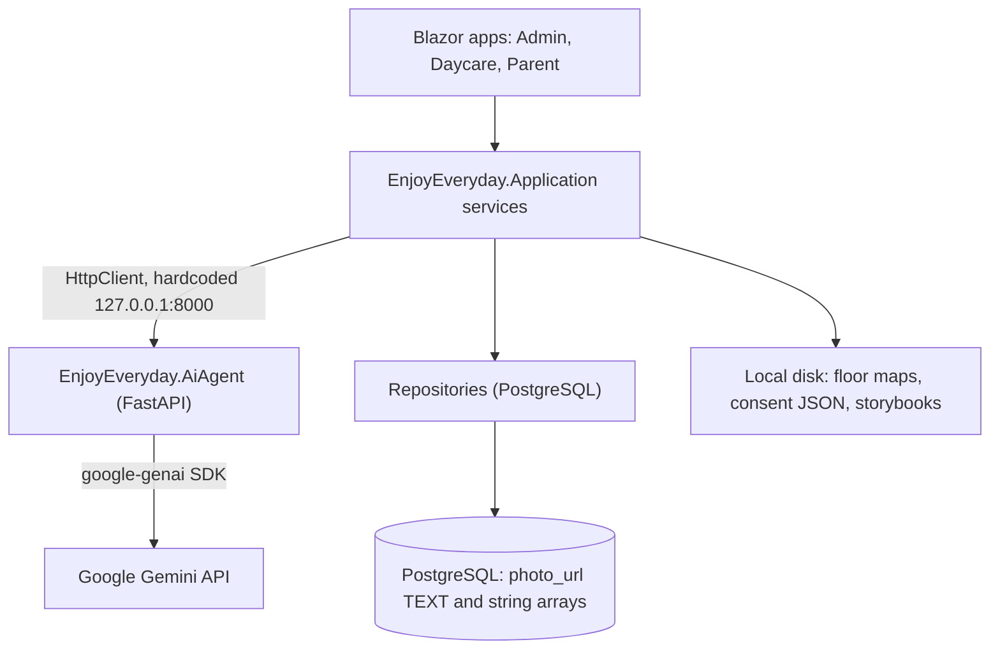

# Provider Independence — Stage 0 Assessment

> Status: **Stage 0 (inspection only)**. No provider code has been changed.
> Date: 2026-10-23

## 1. Summary

The current system depends on far fewer outside vendors than the requirement expects:

| Assumed in requirement | What the code actually does |
|---|---|
| Azure Blob / GCS / S3 storage | **No cloud storage SDK is used.** Files are saved on local disk or stored inline in the database. |
| Google ADK agents and tool calling | **ADK is not used.** The Python service calls Gemini directly with `google-genai`. |
| LiteLLM | Not used. |
| Embeddings / vector database | **None.** No embedding generation, no pgvector, no vector columns. |
| Provider config in .NET | The AI service URL is **hardcoded** (`http://127.0.0.1:8000`). |

So this work is mainly about **adding** a storage layer and **wrapping** one AI provider. There is very little existing vendor code to migrate away from.

## 2. Current architecture



### 2.1 AI path
- **Python** [gemini_provider.py](file:///c:/MyDrive/ProjectDrive/EnjoyEveryDay/src/EnjoyEveryday.AiAgent/app/providers/gemini_provider.py): a single `GeminiProvider.generate_json(...)` method. It handles JSON output, timeout, rate limiting and model fallback. Six API modules call it: ideas, journey_insights, organization_intelligence, parent_communication, recommendations and weekly_plan.
- **API keys**: each tenant supplies its own Gemini key. It is stored encrypted in `tenants.encrypted_ai_api_key` (migration 014, `AesEncryptionService`) and sent to the Python service in the `X-Tenant-Api-Key` header ([auth.py](file:///c:/MyDrive/ProjectDrive/EnjoyEveryDay/src/EnjoyEveryday.AiAgent/app/security/auth.py)). Field name: `TenantContext.gemini_api_key`.
- **.NET** [ApplicationServiceRegistration.cs](file:///c:/MyDrive/ProjectDrive/EnjoyEveryDay/src/EnjoyEveryday.Application/ApplicationServiceRegistration.cs): six typed `HttpClient` services (`AiIdeaService`, `ActivityRecommendationService`, `ChildJourneyInsightService`, `WeeklyPlanningAssistantService`, `ParentCommunicationAssistantService`, `OrganizationIntelligenceService`). They share a hardcoded base address and a 15 s timeout.
- **Model selection**: `GEMINI_MODEL` environment variable, plus a hardcoded `FALLBACK_MODELS` list.

### 2.2 Storage path
| Data | Current mechanism | Notes |
|---|---|---|
| Floor maps | `IFloorMapStorageService` → `LocalFloorMapStorageService` (`bin/Storage/FloorMaps`) | **Best starting point.** Already stores a storage key, SHA-256 hash, validated MIME type and size. |
| Consent records | `ConsentStorageService` → `File.WriteAllTextAsync` | Local JSON files. |
| Storybooks | `Daycare.Web/Services/StorybookStorageService` → local HTML | Lives in the web project, not in Application. |
| Child, teacher, classroom and pickup photos | `photo_url` TEXT columns | Images are converted to AVIF in the browser (`imageConverter.js`). They appear to be saved as data URLs. Migration 009 widened `photo_url` to TEXT. **Needs confirmation.** |
| Event photos | `events.photo_urls string[]` (max 3) | Same data-URL pattern is likely. |
| Memories | `MemoryEntities.MediaUrl` | |
| Material images | `ImageUrl` | Probably external URLs typed in by admins. |

## 3. Direct provider dependencies

| # | Location | Dependency | Risk |
|---|---|---|---|
| D1 | `AiAgent/app/providers/gemini_provider.py` | `google.genai` | The only AI vendor coupling. Already isolated in one class. |
| D2 | `AiAgent/app/security/*` | Field and header named for Gemini | Naming only. |
| D3 | `AiAgent/app/config.py` | `GEMINI_*` environment variables | Needs a provider-neutral config. |
| D4 | `Application/ApplicationServiceRegistration.cs` | Hardcoded AI base URL | **Violates the "no hardcoded provider" rule.** Fix first. |
| D5 | `LocalFloorMapStorageService`, `ConsentStorageService`, `StorybookStorageService` | Local file system | Data is lost when a container is redeployed. This is the real driver for object storage. |
| D6 | `photo_url` / `photo_urls` / `MediaUrl` columns | Inline image data or URLs used as identifiers | Conflicts with "use an internal object reference". |

## 4. Proposed interfaces

### 4.1 Storage (.NET, `EnjoyEveryday.Application` abstractions, adapters in `EnjoyEveryday.Infrastructure`)
```csharp
public interface IObjectStorage
{
    string ProviderId { get; }
    ObjectStorageCapabilities Capabilities { get; }   // SignedUrls, ServerSideCopy, ...
    Task<StoredObject> UploadAsync(ObjectUploadRequest req, Stream content, CancellationToken ct);
    Task<Stream> OpenReadAsync(ObjectLocation loc, CancellationToken ct);
    Task<bool> ExistsAsync(ObjectLocation loc, CancellationToken ct);
    Task<ObjectMetadata?> GetMetadataAsync(ObjectLocation loc, CancellationToken ct);
    Task DeleteAsync(ObjectLocation loc, CancellationToken ct);
    Task<Uri?> GetTemporaryReadUrlAsync(ObjectLocation loc, TimeSpan ttl, CancellationToken ct); // null if unsupported
}
public interface IObjectStorageRegistry { IObjectStorage Default { get; } IObjectStorage Get(string providerId); }
```
- `ObjectLocation` = (ProviderId, Container, Key). Business code keeps a `media_object_id`, never a provider URL.
- Errors are normalized to `ObjectStorageException` with a `Kind` (NotFound, Unauthorized, Transient, Misconfigured).
- First adapters: `LocalFileSystem` (wraps today's behaviour), `S3Compatible` (Amazon S3 **and** Cloudflare R2 through the AWSSDK.S3 client with `ServiceURL`), `AzureBlob`, `GoogleCloudStorage`.
- `IFloorMapStorageService` becomes a thin wrapper over `IObjectStorage`. Its validation and hashing logic is kept.

### 4.2 AI (Python, at the provider boundary)
There is no ADK agent to preserve. The right boundary is the existing `generate_json` call:
```python
class AIProvider(Protocol):
    provider_id: str
    capabilities: AICapabilities        # json_output, streaming, tools, vision
    async def generate_json(self, req: GenerationRequest, ctx: TenantContext) -> GenerationResult: ...
# GenerationResult: data, provider_id, model, input_tokens, output_tokens, latency_ms
```
- `GeminiProvider` is refactored to implement this protocol, with its behaviour unchanged.
- Adapters: `OpenAIProvider`, `AnthropicProvider` (JSON via a tool or schema), `OllamaProvider` (`format: json`).
- A registry selects the provider from config. The six API modules depend only on the registry.
- The .NET side stays provider-neutral. It only needs a configurable `AiAgent:BaseUrl` and timeout.
- `IEmbeddingProvider` is **deferred**: nothing uses embeddings today. The requirement's rules (record model and dimensions, never mix spaces) will apply when retrieval is introduced.

### 4.3 Configuration (conceptual)
```json
"Providers": {
  "Storage": { "DefaultProvider": "Local", "Local": { "Root": "Storage" }, "CloudflareR2": { "AccountId": "", "Bucket": "" } },
  "AiAgent": { "BaseUrl": "http://127.0.0.1:8000", "TimeoutSeconds": 15 }
}
```
Python: `AI_PROVIDER=gemini|openai|anthropic|ollama`, `AI_MODEL=...`. Options are validated with `ValidateOnStart()`. Unknown IDs fail startup. Secrets come only from environment variables or user-secrets.

## 5. Migration risks and decisions needed

| # | Risk / open question | Recommendation |
|---|---|---|
| R1 | **Tenant-supplied keys are Gemini keys.** Changing the provider means tenants need a key for the new vendor, or the platform supplies one. | Decide the key ownership model before Stage 3. Store a `ai_provider` value alongside `encrypted_ai_api_key`. |
| R2 | The silent `FALLBACK_MODELS` loop goes against "never silently use a weaker model". | Make the fallback list explicit config. Record the model actually used in the result. |
| R3 | Photos are inline in the DB (to be confirmed). Moving them to object storage needs a **schema change** (`media_objects` table plus FK columns) and a backfill. | Write the schema proposal in Stage 1. Keep data-URL reads working while both forms exist. |
| R4 | Local-disk files disappear on redeploy, and floor maps and consent records are safety-critical. | Move them to `IObjectStorage` first, starting with the Local adapter so behaviour doesn't change. |
| R5 | Sending child data to a new AI vendor needs a privacy review. | The provider registry gets an `approved_for_child_data` flag. Unapproved providers are rejected at request time. |
| R6 | Runtime switching. Blazor Server plus `IOptionsMonitor` can reload, but the Python service reads environment variables only at startup. | Version 1 switches by **controlled restart**. Runtime switching is Stage 5. |
| R7 | GCS and Azure SDKs add package weight. | Ship Local plus S3-compatible (covers S3 and R2) first. Add Azure and GCS when they are actually needed. |

## 6. Tests (inventory only — none executed per GEMINI.md §6)
- `EnjoyEveryday.Application.Tests` (for example `FloorMapAndEmergencyContactTests`, `ParentServiceTests`)
- `EnjoyEveryday.IntegrationTests`, `EnjoyEveryday.MemoryLayer.Tests`
- `EnjoyEveryday.AiAgent/tests` (pytest; `set_mock_handler` already provides an injectable mock)

## 7. Implementation phases (revised to match the real codebase)

| Stage | Scope |
|---|---|
| 1 | `IObjectStorage` + Local adapter + registry + options. Route floor maps, consent and storybooks through it. Write the `media_objects` schema proposal (doc only). |
| 2 | Python `AIProvider` protocol + registry. Refactor Gemini to implement it. Make the .NET `AiAgent:BaseUrl` configurable. |
| 3 | S3-compatible adapter (S3 and R2). OpenAI adapter. Decide R1. |
| 4 | Validated config, startup validation, health checks. |
| 5 | Controlled switching, audit events, rollback runbook. |
| 6 | Photo backfill into `media_objects` and the migration tool (after schema approval). |
| 7 | Platform Admin "Providers" page (read-only first). |
| 8 | Optional compatible fallback, Anthropic/Ollama/Azure/GCS adapters as needed. |

The other documents (`provider-configuration.md`, `storage-migration-runbook.md`, `ai-provider-compatibility.md`, `provider-operations.md`) will be written during the stages that produce their content.
