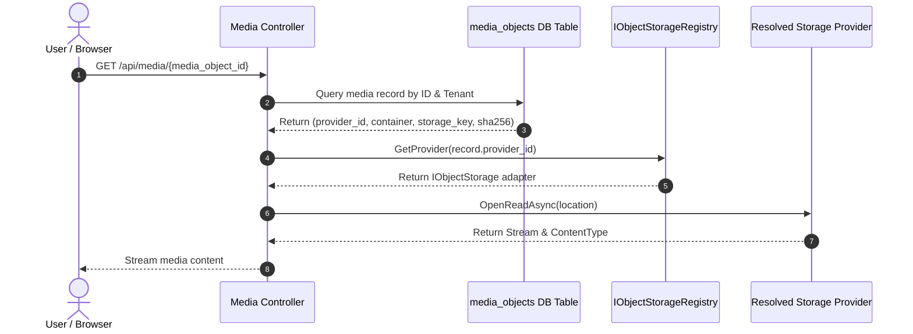

# Storage Migration Runbook

> Document: `docs/architecture/storage-migration-runbook.md`  
> Status: **Stage 5 / Stage 6 Operational Runbook**  
> Scope: Safe, idempotent migration of daycare media objects between storage providers (Local, Azure Blob, S3, Cloudflare R2).

---

## 1. Migration Principles & Guarantees

1. **No Cold Cutover**: Older photos remain available from their originating provider while new uploads use the new default provider.
2. **Read-Before-Delete / Verification First**: Objects are NEVER deleted from the source provider until destination readability, byte length, and SHA-256 checksums match.
3. **Bounded Batch Processing**: Migrations run in bounded batches (default: 50 items/batch) with concurrency limits to prevent rate-limiting or network saturation.
4. **Idempotent Execution**: If a migration task is restarted or interrupted, items with matching checksums at the destination are skipped automatically without duplication.
5. **Immediate Rollback**: Switching the default provider back requires only a configuration change (`DefaultProvider`), leaving legacy and migrated objects fully accessible.

---

## 2. Multi-Provider Resolution Lifecycle



---

## 3. Step-by-Step Migration Execution

### Phase 1: Pre-Migration Validation
1. Verify target provider credentials and permissions:
   - Ensure the destination bucket exists and has read/write IAM policies.
   - Run a non-destructive probe test (e.g., upload a 1-byte health probe file and delete it).
2. Confirm the database table `media_objects` is populated and indexed.

### Phase 2: Batch Copying
1. Select unmigrated objects:
   ```sql
   SELECT id, provider_id, container, storage_key, sha256_hash, size_bytes
   FROM media_objects
   WHERE provider_id = 'Local' AND migration_status != 'Migrated'
   ORDER BY created_at ASC
   LIMIT 50;
   ```
2. For each item:
   - Stream content from `sourceProvider.OpenReadAsync(...)`.
   - Calculate SHA-256 while streaming into `destinationProvider.UploadAsync(...)`.
   - Verify: `computedHash == item.sha256_hash && uploadedBytes == item.size_bytes`.
3. Update database record:
   ```sql
   UPDATE media_objects
   SET provider_id = 'CloudflareR2',
       container = 'enjoyeveryday-r2-prod',
       migration_status = 'Migrated',
       updated_at = CURRENT_TIMESTAMP
   WHERE id = :id;
   ```

### Phase 3: Verification & Source Retention
1. Retain source objects for a mandatory retention grace period (recommended: **14 days**).
2. Audit access logs for 404s or access anomalies.
3. Run checksum sampling:
   - Verify 5% random sample by opening read streams from the destination and confirming integrity.

---

## 4. Rollback Procedure

If issues arise with the new destination provider (e.g. latency, credential rotation issues, rate limits):

1. **Revert Default Provider**:
   Change configuration setting:
   ```bash
   Providers__Storage__DefaultProvider=Local
   ```
2. **Restart Services**:
   Initiate controlled rolling restart of web applications.
3. **Result**:
   - New uploads write to Local disk.
   - Objects copied during the migration retain their pointer in `media_objects` and continue to resolve from the destination, OR can be pointed back to the retained source records.
   - **Zero downtime** and **zero data loss**.
