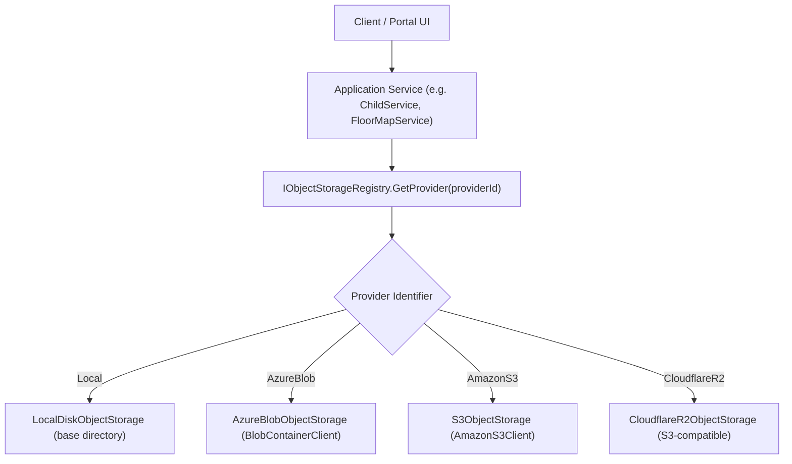

# Architecture Proposal: Non-Breaking Media Objects & Storage Mapping

> Status: **Proposed for Stage 1 / Stage 5 Migration**  
> Context: Supports provider independence without breaking current data-URL or relative photo paths.

## 1. Motivation

Currently, entities like `Child`, `Teacher`, `Classroom`, `Event`, and `AuthorizedPickup` reference photos either via strings (data URLs or path strings in `photo_url`/`photo_urls`). 

To make storage provider-independent (supporting **Local Disk**, **Azure Blob**, **Amazon S3**, and **Cloudflare R2**):
1. Business code and database entities must not rely on provider-specific public URLs.
2. The system requires an internal, immutable object reference (`media_object_id`) that maps to provider metadata (which provider holds the file, bucket/container, provider key, sha256 checksum, and size).
3. The migration must be strictly **non-breaking**: existing `photo_url` values remain valid and accessible while modern uploads use `media_objects`.

---

## 2. Proposed Database Schema: `media_objects`

```sql
-- Migration: 054_media_objects.sql (Draft Proposal)

CREATE TABLE IF NOT EXISTS media_objects (
    id UUID PRIMARY KEY DEFAULT gen_random_uuid(),
    tenant_id UUID NOT NULL REFERENCES tenants(id) ON DELETE CASCADE,
    
    -- Storage provider attribution
    provider_id VARCHAR(50) NOT NULL,          -- 'Local', 'AzureBlob', 'AmazonS3', 'CloudflareR2'
    container VARCHAR(120) NOT NULL,           -- Bucket name or local container folder
    storage_key VARCHAR(500) NOT NULL,         -- Object key within provider
    
    -- Content metadata
    content_type VARCHAR(100) NOT NULL,        -- 'image/webp', 'image/jpeg', 'application/pdf'
    size_bytes BIGINT NOT NULL,
    sha256_hash VARCHAR(64) NOT NULL,
    
    -- Ownership & Authorization context
    entity_type VARCHAR(60),                   -- 'Child', 'Teacher', 'FloorMap', 'Event', etc.
    entity_id UUID,                            -- Optional FK to the owner entity
    is_private BOOLEAN NOT NULL DEFAULT TRUE,
    
    -- Lifecycle
    migration_status VARCHAR(40) NOT NULL DEFAULT 'Active', -- 'Active', 'Migrating', 'Archived'
    created_at TIMESTAMPTZ NOT NULL DEFAULT CURRENT_TIMESTAMP,
    updated_at TIMESTAMPTZ NOT NULL DEFAULT CURRENT_TIMESTAMP
);

CREATE INDEX IF NOT EXISTS idx_media_objects_tenant ON media_objects(tenant_id);
CREATE INDEX IF NOT EXISTS idx_media_objects_lookup ON media_objects(provider_id, container, storage_key);
CREATE INDEX IF NOT EXISTS idx_media_objects_entity ON media_objects(entity_type, entity_id);
```

---

## 3. Storage Provider Resolution Flow



---

## 4. Backwards-Compatibility Guarantee

1. **Legacy URLs / Data URIs**:
   Existing `photo_url` columns remain untouched. The UI and API check if `photo_url` starts with `data:` or `http:`. If so, it renders directly.
2. **Object Storage References**:
   When referencing an object stored via `IObjectStorage`, URLs follow the canonical resolver route:
   `/api/media/{media_object_id}` or `/storage/{container}/{key}`, which checks authorization and streams from the registered provider.
3. **No Downtime Transition**:
   New uploads write a row to `media_objects` and store the reference. Older records are backfilled iteratively in Stage 6 without service interruption.
