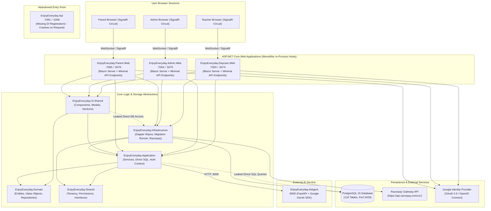
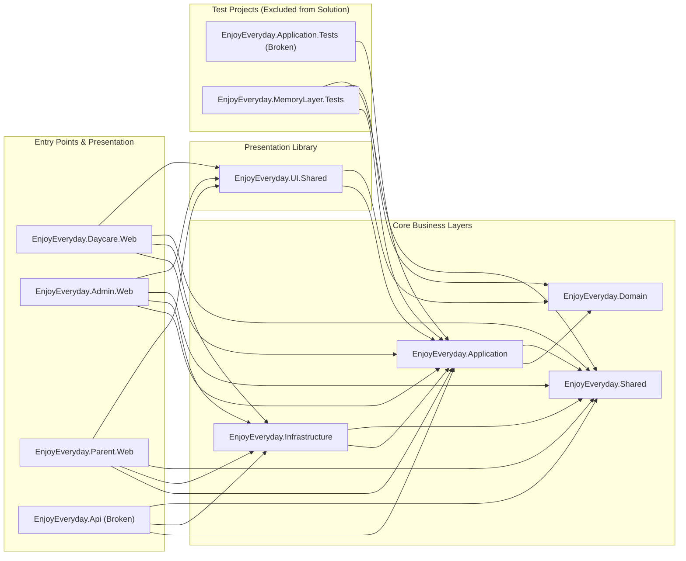

# EnjoyEveryday — Architecture Assessment

## 1. High-Level System Architecture

The EnjoyEveryday application is structured as a collection of ASP.NET Core Blazor Interactive Server applications, an abandoned REST API host, an external Python AI sidecar, and a PostgreSQL database.

---

## 2. Project and Dependency Diagram

The observed project reference graph demonstrates unexpected boundary directions and leaks:

---

## 3. Module Dependency Matrix

The table below summarizes cross-module references and dependency directions across the solution:

| Module / Project | Target Framework | Depends On | Depended On By | Boundary Violations / Architectural Leaks |
|:---|:---|:---|:---|:---|
| **EnjoyEveryday.Domain** | `net10.0` | None | Application, UIShared, MemTests | Clean; zero external dependencies. Pure POCOs and entity models. |
| **EnjoyEveryday.Shared** | `net10.0` | None | Application, Infrastructure, Api, Web Hosts, MemTests | Clean; contains core tenant/user interfaces and authorization constants. |
| **EnjoyEveryday.Application** | `net10.0` | Domain, Shared | Infrastructure, UIShared, Api, Web Hosts, AppTests, MemTests | **Severe**: References `Dapper` package. 10 services run raw SQL and inject `IDbConnectionFactory`. |
| **EnjoyEveryday.Infrastructure** | `net10.0` | Application, Shared | Api, Web Hosts | References `Npgsql`, `Dapper`. Houses repository implementations and migrations. |
| **EnjoyEveryday.UI.Shared** | `net10.0` | Application, Domain | Daycare.Web, Admin.Web, Parent.Web | **Severe**: Component `ActiveSessionModal.razor` injects `IDbConnectionFactory`, imports `Dapper`, runs raw SQL. |
| **EnjoyEveryday.Daycare.Web** | `net10.0` | Application, Infrastructure, Shared, UI.Shared | None | In-process monolith host. Directly queries DB in `AuthEndpoints.cs`. |
| **EnjoyEveryday.Admin.Web** | `net10.0` | Application, Infrastructure, Shared, UI.Shared | None | In-process monolith host. Duplicates 20 pages from Daycare.Web. |
| **EnjoyEveryday.Parent.Web** | `net10.0` | Application, Infrastructure, Shared, UI.Shared | None | In-process monolith host. Duplicates Google authentication logic. |
| **EnjoyEveryday.Api** | `net10.0` | Application, Infrastructure, Shared | None | **Critical**: Abandoned. Omits DI registrations in `Program.cs`. Crashes on request. |
| **EnjoyEveryday.Application.Tests** | `net10.0` | Application | None | **Critical**: Excluded from solution file. Has 9 compilation errors. |
| **EnjoyEveryday.AiAgent** | Python 3.11+ | `google-genai`, `fastapi`, `pydantic` | Called via HTTP by Application | Standalone service; not referenced in solution, missing startup script in `run.ps1`. |

---

## 4. Database Ownership and Access Map

EnjoyEveryday uses a shared-database, discriminator-column multi-tenancy model backed by PostgreSQL.

### Table Ownership by Domain:
1. **Core Tenancy & Organization** (`tenants`, `organizations`, `branches`, `classrooms`, `organization_memberships`, `user_organization_roles`):
   - Owned by: `OrganizationRepository`, `BranchRepository`, `ClassroomRepository`, `AccessScopeRepository`.
   - Access paths: Fully guarded by tenant ID and composite foreign keys.
2. **Identity & User Management** (`users`, `roles`, `permissions`, `user_roles`, `user_external_logins`):
   - Owned by: `UserRepository`, `AuthEndpoints` in Web apps.
   - Access paths: Direct Dapper SQL queries in `AuthEndpoints` bypass repositories.
3. **Child & Family Domain** (`children`, `family_relationships`, `child_guardians`, `authorized_pickups`, `child_care_*`):
   - Owned by: `ChildRepository`, `ChildDailyCareRepository`, `SecurePickupService`.
   - Access paths: Guarded by `ResourceAuthorizer` in `ChildService`; bypassed in `SecurePickupService`.
4. **Attendance** (`child_attendance`, `teacher_attendance`):
   - Owned by: `AttendanceRepository`.
   - Access paths: Accessed by `AttendanceService` and leaked into `ActiveSessionModal.razor` (raw SQL without tenant scope).
5. **Learning & Experiences** (`experiences`, `experience_versions`, `experience_schedules`, `experience_sessions`, `child_journey_entries`):
   - Owned by: `ExperienceRepository`, `ExperienceSessionRepository`, `ChildJourneyRepository`.
   - Access paths: `MemoryService` and `ExecutionService` bypass repositories with raw SQL.
6. **Commercial, Billing & Warehouse** (`invoices`, `invoice_line_items`, `payments`, `material_*`, `inventory_*`):
   - Owned by: `BillingRepository`, `MaterialMarketplaceRepository`.
   - Access paths: High N+1 query overhead in `BillingRepository`. Direct SQL in `AccountBookService` and `EnrollmentPipelineService`.

---

## 5. Circular and Undesirable Dependencies

1. **Application Layer Depending on Database Drivers**:
   `EnjoyEveryday.Application.csproj` directly references `Dapper` (v2.1.89). Application services should orchestrate domain logic and depend solely on domain repository abstractions. Referencing Dapper encouraged developers to write raw SQL directly in services rather than in Infrastructure.
2. **Presentation Layer Depending on Database Driver**:
   `ActiveSessionModal.razor` in `EnjoyEveryday.UI.Shared` contains `@inject IDbConnectionFactory Db` and `@using Dapper`. A presentation component should never communicate directly with a database connection.
3. **UI Monolithic In-Process Hosting vs API Separation**:
   All three Web projects reference `EnjoyEveryday.Infrastructure` directly to register SQL connection factories and repositories. The intended separation where Web frontends communicate through `EnjoyEveryday.Api` was abandoned, creating three distinct monolithic servers running against the same database.

---

## 6. Architectural Inconsistencies: Documentation vs. Implementation

| Stated / Documented Architecture | Actual Code Implementation | Impact / Consequence |
|:---|:---|:---|
| **API Backend**: `run.ps1` claims: *"Start the API Project in a new PowerShell window... API: https://localhost:7081"* | `EnjoyEveryday.Api/Program.cs` registers no application or infrastructure services. The API throws `InvalidOperationException` on any controller invocation. Web apps do not call the API at all. | Disconnect confuses developers and breaks automated API testing. |
| **Clean Architecture / Repository Pattern**: Documented in records as having clean Domain / Repository / Service separation. | 10 major application services and 1 UI component bypass repositories and execute raw Dapper SQL queries. | Architectural duality: two competing ways of accessing data in the same solution. |
| **Automated Test Coverage**: `PROJECT_STATE.md` states: *"Clean compilation and 100% passing test suite (87 tests passing)"*. | Test projects are excluded from `EnjoyEveryday.slnx` and fail to compile with 9 errors. Tests have not run since interface refactoring. | False sense of security; broken regression protection. |
| **AI Integration via Sidecar**: AI integration documented as connecting to Python agent on `127.0.0.1:8000`. | 3 out of 5 AI services use relative URLs on an `HttpClient` with no `BaseAddress`, causing guaranteed runtime exceptions and forced fallback. `run.ps1` does not start the Python agent. | AI services do not function in standard development setups. |
| **Shared Component Reusability**: `EnjoyEveryday.UI.Shared` is intended to house common UI components. | 20 entire pages are copy-pasted duplicates between `Daycare.Web` and `Admin.Web`. | Duplicate maintenance, divergent behavior, double bug fixing. |
| **Strict Multi-Tenant Scoping**: All queries documented as being strictly tenant-isolated. | `GetAllInvoicesAsync` accepts nullable `tenantId` and executes across all tenants if null; `ActiveSessionModal.razor` queries attendance without tenant parameter. | Cross-tenant data leakage risks. |
