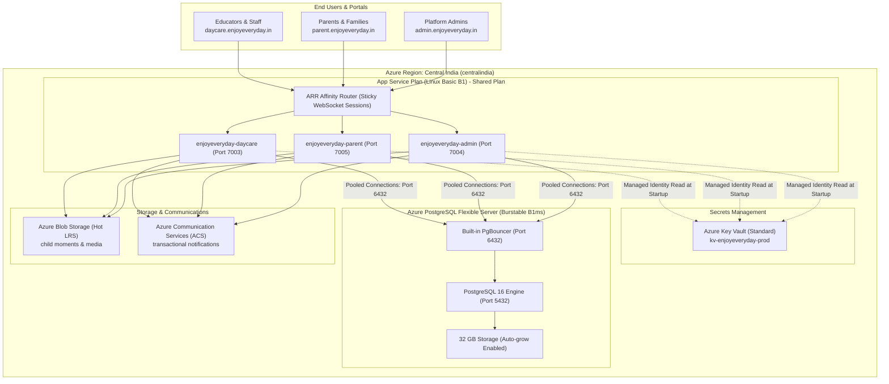

# Azure Deployment Strategy & Runbook: EnjoyEveryday
## Lowest-Cost Production Stack (Central India / INR Billing)

---

## 1. Executive Summary & Cost Breakdown

This deployment strategy provides a cost-effective, scalable production architecture on Microsoft Azure for the **EnjoyEveryday** application stack (Blazor Server portals, REST API, PostgreSQL, and background services).

### Target Specifications
* **Cloud Provider**: Microsoft Azure
* **Target Region**: `centralindia` (Pune / Central India)
* **Billing Currency**: Indian Rupees (INR, ₹)
* **Target Monthly Spend**: **~₹2,500 – ₹2,600 / month** (excluding 18% GST)

---

### Monthly Cost Matrix (INR)

| Component | Azure Resource | Configuration / Tier | Key Cost-Optimization Rationale | Estimated Monthly Cost (INR) |
| :--- | :--- | :--- | :--- | :--- |
| **Web Compute** | Azure App Service (Linux) | **Basic B1**<br/>(1 vCPU, 1.75 GB RAM) | Single plan hosting multiple Web Apps (`Daycare.Web`, `Parent.Web`, `Admin.Web`). Supports custom domains, managed TLS/SSL, and WebSockets for Blazor Server. | ~₹1,120 |
| **Relational Database** | Azure Database for PostgreSQL Flexible Server | **Burstable B1ms**<br/>(1 vCPU, 2 GB RAM, 32 GB SSD) | Minimum viable tier with built-in **PgBouncer** enabled (`port 6432`). Connection pooling prevents memory exhaustion on burstable compute. | ~₹1,290 |
| **Secrets & Keys** | Azure Key Vault | **Standard** (RBAC Authorization) | No monthly base charge. Pay-as-you-go secret operations (~₹2.50 per 10,000 transactions). Resolved via Managed Identity at startup. | ~₹0 – ₹25 |
| **Media / Blob Storage** | Azure Storage Account | **Standard LRS, Hot** | Stores child daily care moments, documents, and media uploads. | ~₹125 (~50–100 GB) |
| **Transactional Email** | Azure Communication Services (ACS) | Pay-as-you-go | Flat rate (~₹0.02 per email delivered). | ~₹25 (~1,000 emails) |
| **Domain & SSL** | App Service Managed Certificates | Standard SNI SSL | Native auto-renewing TLS certificates for custom domains. | **₹0 (Free)** |
| **CI / CD** | GitHub Actions | Standard Ubuntu Runner | Deployment pipeline within GitHub's free allowance. | **₹0 (Free)** |
| **Total Estimated** | | | | **~₹2,560 – ₹2,600 / month** |

> [!TIP]
> **Azure Free Account Credit**: New Azure accounts include 12 months of popular free services, including 750 hours/month of B1ms PostgreSQL and 750 hours/month of B1 Linux App Service, dropping early infrastructure costs down to nominal usage fees (~₹100–₹300/mo).

---

## 2. Architectural Blueprint



---

## 3. Step-by-Step Deployment Instructions

### Prerequisites
1. An active Azure subscription configured with **India** as the billing country (invoices billed in INR).
2. Azure CLI installed (`az`) and authenticated.

---

### Step 1: Create Resource Group in Central India

```powershell
# Log in to Azure
az login

# Set active subscription (if multiple exist)
az account set --subscription "<YOUR_SUBSCRIPTION_NAME_OR_ID>"

# Create Resource Group in Central India
az group create --name rg-enjoyeveryday-prod --location centralindia
```

---

### Step 2: Provision PostgreSQL Flexible Server

To keep costs minimal while handling concurrent Blazor Server database hits, deploy a **Burstable B1ms** instance with built-in **PgBouncer** connection pooling.

```powershell
# 1. Provision PostgreSQL Flexible Server
az postgres flexible-server create `
  --resource-group rg-enjoyeveryday-prod `
  --name psql-enjoyeveryday-prod `
  --location centralindia `
  --admin-user pgadmin `
  --admin-password "<SECURE_DB_PASSWORD>" `
  --sku-name Standard_B1ms `
  --tier Burstable `
  --storage-size 32 `
  --version 16 `
  --public-access 0.0.0.0

# 2. Enable Built-in PgBouncer (Connection Pooling)
az postgres flexible-server parameter set `
  --resource-group rg-enjoyeveryday-prod `
  --server-name psql-enjoyeveryday-prod `
  --name pgbouncer.enabled `
  --value true

# 3. Create the Application Database
az postgres flexible-server db create `
  --resource-group rg-enjoyeveryday-prod `
  --server-name psql-enjoyeveryday-prod `
  --database-name enjoyeveryday
```

> [!IMPORTANT]
> The `--public-access 0.0.0.0` rule enables "Allow public access from any Azure service within Azure to this server". This allows App Service to communicate with PostgreSQL directly over TLS without requiring a Virtual Network NAT Gateway (~₹2,800/mo extra). Always enforce `SSL Mode=Require`.

---

### Step 3: Provision Azure Key Vault & Store Application Secrets

Deploy a **Standard** Key Vault utilizing **Azure RBAC Authorization**.

```powershell
# 1. Create Key Vault
az keyvault create `
  --name kv-enjoyeveryday-prod `
  --resource-group rg-enjoyeveryday-prod `
  --location centralindia `
  --sku standard `
  --enable-rbac-authorization true

# 2. Create Storage Account for Media
az storage account create `
  --name stenjoyeverydayprod `
  --resource-group rg-enjoyeveryday-prod `
  --location centralindia `
  --sku Standard_LRS `
  --kind StorageV2

# Retrieve storage connection string
$STORAGE_CONN = az storage account show-connection-string --name stenjoyeverydayprod --resource-group rg-enjoyeveryday-prod --query connectionString -o tsv

# 3. Store Database Connection String (Note Port 6432 for PgBouncer)
az keyvault secret set --vault-name kv-enjoyeveryday-prod --name "DbConnectionString" `
  --value "Host=psql-enjoyeveryday-prod.postgres.database.azure.com;Port=6432;Database=enjoyeveryday;Username=pgadmin;Password=<SECURE_DB_PASSWORD>;SSL Mode=Require;Trust Server Certificate=true;"

# 4. Store Storage Connection String
az keyvault secret set --vault-name kv-enjoyeveryday-prod --name "StorageConnectionString" `
  --value "$STORAGE_CONN"
```

---

### Step 4: Provision App Service Plan & Web Apps

Deploy a **single** Linux Basic (`B1`) plan to host all portals.

```powershell
# 1. Create Shared Linux App Service Plan (Basic B1)
az appservice plan create `
  --name asp-enjoyeveryday-prod `
  --resource-group rg-enjoyeveryday-prod `
  --location centralindia `
  --is-linux `
  --sku B1

# 2. Create the Three Web Apps on the Shared Plan
az webapp create --resource-group rg-enjoyeveryday-prod --plan asp-enjoyeveryday-prod --name enjoyeveryday-daycare --runtime "DOTNETCORE:10.0"
az webapp create --resource-group rg-enjoyeveryday-prod --plan asp-enjoyeveryday-prod --name enjoyeveryday-parent  --runtime "DOTNETCORE:10.0"
az webapp create --resource-group rg-enjoyeveryday-prod --plan asp-enjoyeveryday-prod --name enjoyeveryday-admin   --runtime "DOTNETCORE:10.0"

# 3. Configure Essential Blazor Server Settings (WebSockets, ARR Affinity, Always On)
$apps = @("enjoyeveryday-daycare", "enjoyeveryday-parent", "enjoyeveryday-admin")
foreach ($app in $apps) {
    az webapp config set --resource-group rg-enjoyeveryday-prod --name $app --web-sockets-enabled true --always-on true
    az webapp update --resource-group rg-enjoyeveryday-prod --name $app --client-affinity-enabled true
}
```

---

### Step 5: Wire Key Vault via Managed Identity (Zero Code Changes)

Using **App Service Key Vault References**, Azure securely fetches secrets at startup and passes them into standard .NET `IConfiguration` keys.

```powershell
# 1. Enable System-Assigned Managed Identity on Each Web App
foreach ($app in $apps) {
    az webapp identity assign --resource-group rg-enjoyeveryday-prod --name $app
}

# 2. Obtain Key Vault Resource ID
$KV_ID = az keyvault show --name kv-enjoyeveryday-prod --resource-group rg-enjoyeveryday-prod --query id -o tsv

# 3. Grant "Key Vault Secrets User" Role to Each Web App
foreach ($app in $apps) {
    $PRINCIPAL_ID = az webapp identity show --name $app --resource-group rg-enjoyeveryday-prod --query principalId -o tsv
    az role assignment create --role "Key Vault Secrets User" --assignee-object-id $PRINCIPAL_ID --assignee-principal-type ServicePrincipal --scope $KV_ID
}

# 4. Set Key Vault Reference Configuration Keys on Apps
foreach ($app in $apps) {
    az webapp config appsettings set --resource-group rg-enjoyeveryday-prod --name $app --settings `
      ASPNETCORE_ENVIRONMENT="Production" `
      ConnectionStrings__DefaultConnection="@Microsoft.KeyVault(VaultName=kv-enjoyeveryday-prod;SecretName=DbConnectionString)" `
      Azure__StorageConnectionString="@Microsoft.KeyVault(VaultName=kv-enjoyeveryday-prod;SecretName=StorageConnectionString)"
}
```

---

## 4. Database Schema Migration

Execute your initial schema and stored procedures located in `src/EnjoyEveryday.DBFullScript` against the Azure PostgreSQL instance.

```powershell
# Direct invocation from local machine with PostgreSQL tools
& "C:\Program Files\PostgreSQL\18\bin\psql.exe" `
  -h psql-enjoyeveryday-prod.postgres.database.azure.com `
  -p 5432 `
  -U pgadmin `
  -d enjoyeveryday `
  -f "src\EnjoyEveryday.DBFullScript\MasterScript.sql"
```

---

## 5. Automated CI/CD Pipeline (GitHub Actions)

Create `.github/workflows/azure-deploy-centralindia.yml` to automatically build and deploy changes to Azure when pushing to `master`:

```yaml
name: Deploy EnjoyEveryday Portals to Azure (Central India)

on:
  push:
    branches: [ master ]

jobs:
  deploy:
    runs-on: ubuntu-latest
    steps:
      - name: Checkout Code
        uses: actions/checkout@v4

      - name: Setup .NET
        uses: actions/setup-dotnet@v4
        with:
          dotnet-version: '10.0.x'

      # Deploy Daycare Web
      - name: Publish Daycare Portal
        run: dotnet publish src/EnjoyEveryday.Daycare.Web/EnjoyEveryday.Daycare.Web.csproj -c Release -o ./publish-daycare

      - name: Deploy Daycare Portal to Azure
        uses: azure/webapps-deploy@v3
        with:
          app-name: 'enjoyeveryday-daycare'
          publish-profile: ${{ secrets.AZURE_DAYCARE_PUBLISH_PROFILE }}
          package: ./publish-daycare

      # Deploy Parent Web
      - name: Publish Parent Portal
        run: dotnet publish src/EnjoyEveryday.Parent.Web/EnjoyEveryday.Parent.Web.csproj -c Release -o ./publish-parent

      - name: Deploy Parent Portal to Azure
        uses: azure/webapps-deploy@v3
        with:
          app-name: 'enjoyeveryday-parent'
          publish-profile: ${{ secrets.AZURE_PARENT_PUBLISH_PROFILE }}
          package: ./publish-parent

      # Deploy Admin Web
      - name: Publish Admin Portal
        run: dotnet publish src/EnjoyEveryday.Admin.Web/EnjoyEveryday.Admin.Web.csproj -c Release -o ./publish-admin

      - name: Deploy Admin Portal to Azure
        uses: azure/webapps-deploy@v3
        with:
          app-name: 'enjoyeveryday-admin'
          publish-profile: ${{ secrets.AZURE_ADMIN_PUBLISH_PROFILE }}
          package: ./publish-admin
```

---

## 6. Critical Cost & Performance Rules

1. **Avoid Azure SignalR Service at Inception**:
   * Azure SignalR Service costs ~₹4,100/mo ($49/mo).
   * App Service with **ARR Affinity enabled** provides sticky WebSocket connections directly to the instance, supporting up to 500 concurrent Blazor circuits on Basic B1 without external SignalR backplanes.
2. **Always Use PgBouncer (Port 6432)**:
   * Direct PostgreSQL connections allocate dedicated process memory. On small 2 GB RAM instances (`B1ms`), direct connection spikes can trigger out-of-memory crashes. PgBouncer multiplexes connections efficiently.
3. **Do Not Use Private Link / VNet NAT Gateways**:
   * Private endpoints and NAT gateways add ~₹2,800+/month. Use PostgreSQL firewall rules (`Allow access from Azure services`), enforce TLS 1.2+ (`Ssl Mode=Require`), and secure secrets with Key Vault RBAC.
4. **Configure Budget Alerts**:
   * In Azure Portal: **Cost Management + Billing -> Budgets**.
   * Create a budget of **₹3,000/month** with alert thresholds at 70%, 85%, and 100% sent to your email.
