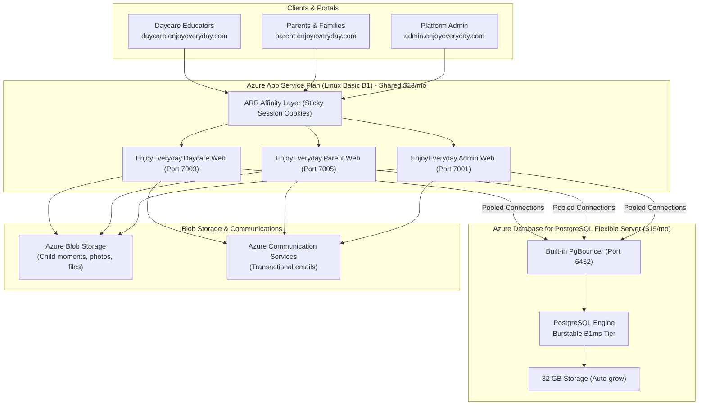

# Azure Deployment & Scalable Cloud Strategy

This guide provides a comprehensive deployment and operations strategy for running **EnjoyEveryday** on Microsoft Azure at minimum cost (~$30–$35/month) while maintaining enterprise readiness, high security, and seamless scaling.

---

## 1. Quick Cost Summary

| Component | Service | Startup Tier | Monthly Cost (USD) |
|:---|:---|:---|:---|
| **Web Apps** | Azure App Service (Linux) | **Basic B1 Plan** (1 vCPU, 1.75 GB RAM) | **$13.14** (Hosts all 3 portals together) |
| **Database** | Azure PostgreSQL Flexible Server | **Burstable B1ms** (1 vCPU, 2 GB RAM, 32 GB SSD) | **$15.20** (PgBouncer connection pooling enabled) |
| **Media / Photos** | Azure Blob Storage | Hot LRS (images, child daily moments) | **~$1.50** (~100 GB) |
| **Email Service** | Azure Communication Services (ACS) | Transactional Email | **~$0.25** (1,000 emails) |
| **Custom SSL** | App Service Managed Certificate | Automated Let's Encrypt TLS | **$0.00** (Free) |
| **CI/CD** | GitHub Actions | Automated build & deploy | **$0.00** (Free tier) |
| **Total** | | | **~$30.00 – $35.00 / month** |

---

## 2. Architecture Diagram



---

## 3. Step-by-Step Provisioning Guide

### Step 1: Resource Group & Location
Create a single Resource Group in the region nearest to your customers (e.g. `rg-enjoyeveryday-prod` in `East US` or `Canada Central`).

### Step 2: Database Provisioning (Azure PostgreSQL Flexible Server)
1. In the Azure Portal, create **Azure Database for PostgreSQL Flexible Server**.
2. Name: `psql-enjoyeveryday-prod`.
3. Compute + Storage:
   - Workload type: **Development / Low-cost**.
   - Compute size: **Burstable B1ms** (1 vCPU, 2 GB RAM).
   - Storage: **32 GB SSD** (check **Auto-grow**).
4. Networking:
   - Select **Allow public access from any Azure service within Azure to this server**.
5. Server Parameters (**CRITICAL FOR PERFORMANCE & COST**):
   - Navigate to **Settings > Server parameters**.
   - Search for `pgbouncer.enabled` and set to **`true`**.
   - Save and let the server reload.
   - Note: Applications must connect on port **`6432`** (not 5432).
6. Restore initial schema using `database_backups/enjoyeveryday_latest.sql`:
   ```powershell
   & "C:\Program Files\PostgreSQL\18\bin\psql.exe" -h psql-enjoyeveryday-prod.postgres.database.azure.com -p 5432 -U pgadmin -d enjoyeveryday -f database_backups/enjoyeveryday_latest.sql
   ```

### Step 3: Web Hosting (Azure App Service Linux Plan)
1. Create a Linux **App Service Plan**:
   - Name: `asp-enjoyeveryday-prod`.
   - Pricing Tier: **Basic B1** (~$13.14/month).
2. Create 3 **Web Apps** selecting the above Plan:
   - `enjoyeveryday-daycare` (.NET 10 / Linux)
   - `enjoyeveryday-parent` (.NET 10 / Linux)
   - `enjoyeveryday-admin` (.NET 10 / Linux)
3. Under **Configuration > General settings**:
   - Ensure **ARR Affinity** is **On** (provides sticky session routing for Blazor Server WebSockets).
   - Ensure **WebSockets** is **On**.
   - Set **Always On** to **On** (keeps circuits warm and eliminates cold-start latency).

### Step 4: Storage Account & Email
1. Create a Storage Account `stenjoyeverydayprod` (Standard general-purpose v2, Hot LRS).
   - Create private/public containers: `child-moments`, `documents`.
2. Create **Azure Communication Services (ACS)** resource:
   - Add a managed domain (or connect your custom email domain `enjoyeveryday.com`).
   - Copy the Connection String.

---

## 4. Application Configuration Settings

In Azure App Service under **Settings > Environment variables**, add:

```ini
# PostgreSQL Connection via PgBouncer
ConnectionStrings__DefaultConnection=Server=psql-enjoyeveryday-prod.postgres.database.azure.com;Port=6432;Database=enjoyeveryday;User Id=pgadmin;Password=YourPassword;Ssl Mode=Require;Trust Server Certificate=true;

# Blob Storage
Azure__StorageConnectionString=DefaultEndpointsProtocol=https;AccountName=stenjoyeverydayprod;AccountKey=...;EndpointSuffix=core.windows.net

# Azure Communication Services
Azure__CommunicationServices__ConnectionString=endpoint=https://acs-enjoyeveryday-prod.communication.azure.com/;accesskey=...
Azure__CommunicationServices__SenderAddress=notifications@enjoyeveryday.com

# Production Environment
ASPNETCORE_ENVIRONMENT=Production
```

---

## 5. Automated CI/CD (GitHub Actions)

Add this workflow file at `.github/workflows/deploy-azure.yml`:

```yaml
name: Deploy EnjoyEveryday Portals to Azure

on:
  push:
    branches: [ master ]

jobs:
  build-and-deploy:
    runs-on: ubuntu-latest
    steps:
      - name: Checkout Code
        uses: actions/checkout@v4

      - name: Setup .NET
        uses: actions/setup-dotnet@v4
        with:
          dotnet-version: '10.0.x'

      # Daycare Web Portal
      - name: Publish Daycare Portal
        run: dotnet publish src/EnjoyEveryday.Daycare.Web/EnjoyEveryday.Daycare.Web.csproj -c Release -o ./publish-daycare

      - name: Deploy Daycare to Azure
        uses: azure/webapps-deploy@v3
        with:
          app-name: 'enjoyeveryday-daycare'
          publish-profile: ${{ secrets.AZURE_DAYCARE_PUBLISH_PROFILE }}
          package: ./publish-daycare

      # Parent Web Portal
      - name: Publish Parent Portal
        run: dotnet publish src/EnjoyEveryday.Parent.Web/EnjoyEveryday.Parent.Web.csproj -c Release -o ./publish-parent

      - name: Deploy Parent to Azure
        uses: azure/webapps-deploy@v3
        with:
          app-name: 'enjoyeveryday-parent'
          publish-profile: ${{ secrets.AZURE_PARENT_PUBLISH_PROFILE }}
          package: ./publish-parent

      # Admin Web Portal
      - name: Publish Admin Portal
        run: dotnet publish src/EnjoyEveryday.Admin.Web/EnjoyEveryday.Admin.Web.csproj -c Release -o ./publish-admin

      - name: Deploy Admin to Azure
        uses: azure/webapps-deploy@v3
        with:
          app-name: 'enjoyeveryday-admin'
          publish-profile: ${{ secrets.AZURE_ADMIN_PUBLISH_PROFILE }}
          package: ./publish-admin
```

---

## 6. Growth Scaling Path

* **1–10 Daycares ($35/mo)**: Single Basic B1 plan + B1ms database handles traffic easily with PgBouncer.
* **10–50 Daycares ($65/mo)**: Upgrade App Service Plan to **Basic B2** or **Standard S1** (enables 2-instance auto-scaling).
* **50–150 Daycares ($115/mo)**: Scale PostgreSQL Flexible Server from B1ms to **B2s** (2 vCPU, 4 GB RAM).
* **150+ Daycares ($220/mo)**: Add **Azure SignalR Service** when exceeding 1,000+ simultaneous live circuits.

